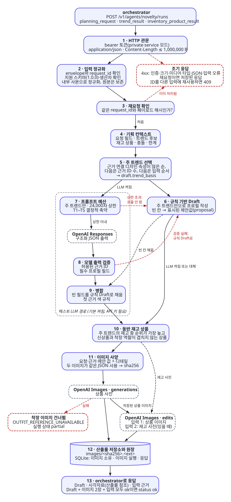

# fashion-planner-novelty

**트렌드를 바탕으로 신상품 기획안 초안과 콘셉트 이미지를 만드는 서비스.** 기획 요청과 트렌드·재고 결과를 받아, 근거가 연결된 상품 기획안(Draft)을 쓴다. 이미지 제공자를 설정하면 같은 옷의 상품 이미지와 착장 이미지도 만든다.

> 이 레포는 **fashion-planner** 5개 레포 중 하나입니다. 전체 구조와 실행 방법은 [fashion-planner-orchestrator](https://github.com/KG-RAG-02/fashion-planner-orchestrator)에서 시작하세요.

| 레포 | 역할 |
|---|---|
| [fashion-planner-orchestrator](https://github.com/KG-RAG-02/fashion-planner-orchestrator) | 기획 질의 구조화, 6단계 워크플로 실행, 웹 UI, 기획서 PNG, Docker 통합 배포 |
| [fashion-planner-trend](https://github.com/KG-RAG-02/fashion-planner-trend) | Vogue Korea 기사에서 트렌드 추출, Neo4j 지식 그래프, 유사 상품 검색 |
| [fashion-planner-inventory](https://github.com/KG-RAG-02/fashion-planner-inventory) | 트렌드에 맞는 과잉재고 상품 매칭(규칙 + CLIP) |
| **[fashion-planner-novelty](https://github.com/KG-RAG-02/fashion-planner-novelty)** | **트렌드 기반 신상품(novelty) 기획안과 제품·착장 이미지 생성** |
| [fashion-planner-research](https://github.com/KG-RAG-02/fashion-planner-research) | 기획안의 판매·시장 조사(가격, 원단 원가, 고객 연령, 타깃) |

novelty는 *신상품*, 곧 아직 없는 상품을 뜻한다. 각 서비스는 혼자 실행하고 테스트할 수 있다.

## 개요

MD가 "2027년 봄·여름 가벼운 아우터"처럼 묻는다. orchestrator는 트렌드와 재고 결과를 모은 뒤 입력 세 개를 한 요청으로 이 서비스에 보낸다. 서비스는 다음 순서로 일한다.

1. 입력을 검증하고 정규화한다. 출처를 추적할 수 있도록 원본 페이로드는 그대로 보관한다.
2. 결정적 규칙으로 **주 트렌드 하나**를 고르고, 그 트렌드만으로 기획한다.
3. **규칙 기반 Draft**를 만든다. 모든 값은 출처(`user_requested`, `evidence_observation`, `proposal` 등)를 밝히고, 이 요청 안의 근거 ID만 인용한다.
4. (선택) **텍스트 LLM**에 더 풍부한 Draft를 요청한다. 응답을 엄격하게 검증하고, 하나라도 어긋나면 규칙 기반 Draft로 돌아간다.
5. (선택) **상품 이미지**를 만든 뒤, 그 이미지를 편집해 기존 재고 상품 하나와 함께 입은 **착장 이미지**를 만든다.
6. 이미지를 내용 해시로 저장하고 로컬 원장에 소유를 기록한 뒤, 이미지 참조와 함께 Draft를 돌려준다.

이 서비스는 다른 서비스를 직접 부르지 않고, 상품이 팔릴지 판단하지 않는다. Draft는 이후 research 서비스와 MD가 검토한다(`review_status: md_review_required`).

## 아키텍처

<picture>
  <source media="(prefers-color-scheme: dark)" srcset="docs/diagrams/request-flow-dark.svg">
  
</picture>

- Draft 데이터 모델: [docs/draft-model.md](docs/draft-model.md)
- 구조 설명: [docs/architecture.md](docs/architecture.md)
- 그림의 상자와 화살표마다 코드 근거를 [docs/diagrams/CLAIMS.md](docs/diagrams/CLAIMS.md)에 적었다.

## 기능

- **HTTP 엔드포인트 하나**, 표준 라이브러리만 사용: `POST /v1/agents/novelty/runs`, `GET /api/health`
- **출처가 있는 값**: Draft의 모든 값에 `kind`와 근거 ID가 붙는다. 입력이 뒷받침하지 않는 값은 `unknown`으로 두거나 `proposal`로 표시한다.
- **Draft마다 주 트렌드 하나**: 규칙으로 고르고 `draft.trend_basis`에 기록한다.
- **엄격한 대체가 있는 텍스트 LLM**: 구조화 출력, 근거 ID 허용 목록, 필수 프로필 필드, 24,000자 결정적 프롬프트 예산을 쓴다. 검증을 통과하지 못한 출력은 Draft에 들어가지 않는다.
- **이미지 두 장, 옷 하나**: 착장 이미지는 저장된 상품 이미지를 편집해 만든다. 두 프롬프트가 같은 사양과 그 SHA-256을 쓴다.
- **유료 호출의 재요청 안전**: 같은 request ID와 페이로드에는 저장된 응답을 돌려준다. 결과를 모르는 유료 이미지 시도는 자동으로 반복하지 않는다.
- **research 계약 보장**: research로 넘어가는 다섯 프로필 값은 120자 이하로 맞추고, 바꾼 필드는 `generation_metadata.length_limited_fields`에 남긴다([docs/draft-model.md](docs/draft-model.md#research로-넘어가는-값)).
- **기본은 오프라인**: API 키가 없어도 유효한 규칙 기반 Draft를 돌려준다. 테스트는 네트워크에 닿지 않는다.

## 빠른 시작(오프라인)

Python 3.11 이상이 필요하다. API 키, 데이터베이스, 다른 서비스는 필요 없다.

```bash
git clone https://github.com/KG-RAG-02/fashion-planner-novelty.git
cd fashion-planner-novelty
python3 -m venv .venv && source .venv/bin/activate
pip install -e .

# 루프백에서 서비스 시작(토큰·TLS·유료 호출 없음)
NOVELTY_HTTP_MODE=local python -m fashion_planner_novelty.server
```

다른 터미널에서 합성 예시 요청을 보낸다.

```bash
curl -s -X POST http://127.0.0.1:8767/v1/agents/novelty/runs \
  -H 'Content-Type: application/json' \
  --data-binary @examples/request.synthetic.json | python3 -m json.tool | head -60
```

결과는 `partial`이고 규칙 기반 Draft가 들어 있다.

- 주 트렌드: `Utility layering`
- 근거가 연결된 값: 색 `olive`, 소재 `nylon`, 디테일 `patch pockets`
- 입력이 다루지 않는 필드: 표시된 제안값
- 두 이미지: `IMAGE_PROVIDER_NOT_CONFIGURED`로 `skipped`

이미지 경로까지 확인하려면 서비스를 `NOVELTY_DRAFT_IMAGE_PROVIDER=synthetic`으로 시작한다. 외부 호출 없이 'SYNTHETIC' 글자가 들어간 자리표시 PNG 두 장(상품, 착장)을 만들어 실제 이미지와 같은 방식으로 저장하고 응답에 싣는다. 이 그림은 상품 디자인이 아니다.

## 설정

환경변수로 설정한다. 로컬 `.env` 파일이 있으면 읽는다([.env.example](.env.example) 참고).

| 변수 | 기본값 | 의미 |
|---|---|---|
| `NOVELTY_HTTP_MODE` | (필수) | `local`: 루프백만, 토큰 없음. `private`: bearer 토큰, 격리 네트워크 안의 평문 HTTP. `service`: bearer 토큰과 TLS |
| `NOVELTY_HOST`, `NOVELTY_PORT` | `127.0.0.1`, `8767` | 수신 주소 |
| `FASHION_PLANNER_SERVICE_TOKEN` | – | `private`·`service` 모드에서 서비스들이 함께 쓰는 bearer 토큰 |
| `NOVELTY_TLS_CERT_FILE`, `NOVELTY_TLS_KEY_FILE` | – | `service` 모드의 인증서와 키 |
| `LLM_API_KEY` | – | 텍스트 LLM과 이미지에 쓰는 OpenAI API 키. 없으면 모델을 부르지 않는다 |
| `NOVELTY_TEXT_GENERATION_ENABLED` | `true` | 키가 있을 때 텍스트 LLM을 쓴다 |
| `NOVELTY_TEXT_GENERATION_MODEL` | `gpt-6-luna` | 텍스트 모델 |
| `NOVELTY_TEXT_GENERATION_TIMEOUT_SECONDS` | `60` | 5–120 범위로 제한 |
| `NOVELTY_TEXT_GENERATION_MAX_OUTPUT_TOKENS` | `3000` | 256–8000 범위로 제한 |
| `NOVELTY_DRAFT_IMAGE_PROVIDER` | (빈 값) | `openai`: 이미지 모델로 만든다(유료). `synthetic`: 외부 호출 없이 SYNTHETIC 자리표시 PNG를 만든다(e2e·데모용, 키 불필요). 비우면 `skipped` |
| `NOVELTY_DRAFT_IMAGE_MODEL` | `gpt-image-2.5-sunburst` | 이미지 모델 |
| `NOVELTY_DRAFT_IMAGE_TIMEOUT_SECONDS` | `180` | 이미지 호출 하나의 시간 제한, 5–300 범위로 제한 |
| `NOVELTY_DRAFT_ARTIFACT_DIR` | `data/local/novelty-artifacts` | 이미지와 SQLite 원장 |

**비용**: `LLM_API_KEY`를 설정하면 실행 한 번에 텍스트 호출 최대 1회, 이미지 호출 최대 2회가 일어난다. 자동 재시도는 없다. `synthetic` 이미지는 호출이 없다.

컨테이너 실행은 [docs/operations.md](docs/operations.md)를 본다. `compose.yaml`은 TLS를 켠 `service` 모드로 서비스를 띄운다.

## 데이터

이 저장소는 **데이터를 담고 있지 않다.** 서비스는 요청마다 들어오는 입력 세 개만 읽는다. 트렌드·재고 결과는 다른 서비스가 만들고, 그 출처는 각 저장소가 밝힌다. 테스트는 작은 합성 픽스처를 쓴다. 실행 중 무엇을 저장하고 모델 제공자에게 무엇을 보내는지는 [docs/data.md](docs/data.md)에 있다.

## API와 계약

`POST /v1/agents/novelty/runs`는 정확히 `contract_version`(`novelty-handoff`), `request_id`, `input`만 있는 envelope를 받는다. `input`에는 정확히 `planning_request`, `trend_result`, `inventory_product_result`가 있어야 하고, 모든 `request_id`가 같아야 한다.

응답 envelope에는 `producer`, `status`, `result`가 있다. 주요 필드는 다음과 같다.

| 필드 | 내용 |
|---|---|
| `result.draft` | Draft: 콘셉트 문장, `product_profile`, `trend_basis`, 한계, 검토 질문 |
| `result.draft.visuals.{product,outfit}` | 상태(`generated`, `failed`, `skipped`), 오류 코드, 산출물 참조(URI, 미디어 타입, 크기, SHA-256), 사양 해시 |
| `result.input_evidence`, `result.compatibility` | 원본 입력, 스키마 버전, 정규화 출처 |
| `result.generation_metadata` | 엔진(`rule_based` 또는 모델), 대체 이유, 프롬프트 축약, 처리 시간 |
| `result.validation_issues` | `partial` 결과의 이유를 기계가 읽을 수 있는 코드로 |

오류 응답은 다음과 같다.

| 코드 | 경우 |
|---|---|
| `400` | JSON 또는 길이 헤더가 잘못됨 |
| `401` | 토큰 없음 |
| `404` | 알 수 없는 경로 |
| `409` | 다른 페이로드에 request ID를 재사용함, 또는 결과를 모르는 이미지 시도가 있음 |
| `413` | 본문이 1,000,000바이트를 넘음 |
| `415` | JSON이 아님 |
| `422` | 입력이 잘못됨 |

전체 계약은 [contracts/http-handoff.md](contracts/http-handoff.md)에 있다.

## 프로젝트 구조

```text
src/fashion_planner_novelty/
├── adapters/      입력 검증과 정규화
├── domain/        기획 컨텍스트, 주 트렌드, 규칙 기반 Draft, 프롬프트 예산, 동반 재고 상품
├── sources/       OpenAI 텍스트 제공자
├── workflows/     기획 분석, 텍스트 생성, 이미지 제공자, 산출물 저장소
├── server/        표준 라이브러리 HTTP 서비스 (python -m fashion_planner_novelty.server)
└── settings.py
prompts/           텍스트 기획·콘셉트 이미지 프롬프트 템플릿 (manifest.json)
contracts/         HTTP 계약 설명
docs/              아키텍처, 데이터 모델, 운영, 데이터 카드, 트러블슈팅, 설계 결정, 다이어그램
scripts/           프롬프트 렌더, 다이어그램 렌더, 오프라인 테스트 실행기
tests/             합성 픽스처를 쓰는 단위 테스트
```

## 테스트

```bash
python scripts/run_offline_tests.py
```

- 실행기는 루프백이 아닌 네트워크 연결을 모두 막고 `unittest` discover를 돌린다. 어떤 테스트든 네트워크에 닿으려 하면 실패한다.
- `PYTHONPATH=src python -m unittest discover -s tests`도 동작하지만 차단을 강제하지는 않는다.
- CI는 Python 3.11과 3.13에서 오프라인 실행기를 돌린다.

## 트러블슈팅과 교훈

[docs/troubleshooting.md](docs/troubleshooting.md)에 겪은 문제와 해결을 모았다. 예를 들어 큰 요청이 왜 `413` 대신 broken pipe로 보였는지, 디자인 디테일이 왜 이미지 프롬프트에 들어가지 않았는지를 다룬다.

## 한계

- Draft는 MD가 출발점으로 삼는 초안이지 결정이 아니다. 수요, 판매, 생산 가능성을 예측하지 않는다.
- 제안값은 빈 칸을 정해진 기본값(예: "레귤러 핏")으로 채우고 표시한 것이다. 근거에서 나온 값이 아니다.
- 근거 ID 검사는 인용한 ID가 이 요청에서 왔다는 것만 증명한다. 출처가 그 주장을 뒷받침한다는 것까지 증명하지는 않는다.
- 두 이미지는 같은 사양을 쓰고 착장이 상품 이미지를 편집하지만, 픽셀 수준의 동일성은 검증하지 않는다.
- 규칙 기반 Draft의 성별 값은 자리표시 제안값(`unknown`)이고, 그대로 이미지 프롬프트에 들어간다.
- 프롬프트 구성은 다층 방어일 뿐 프롬프트 인젝션을 막는다고 보장하지 않는다. [docs/prompt-safety.md](docs/prompt-safety.md) 참고.
- 서비스가 만드는 문장은 한국어다.

## 감사의 말

- 이미지와 텍스트 생성은 설정했을 때 OpenAI API를 쓴다. 이 저장소에는 모델 출력이 없다.
- 다이어그램은 [Graphviz](https://graphviz.org/)와 [librsvg](https://gitlab.gnome.org/GNOME/librsvg)로 렌더하고, 글꼴은 [Pretendard](https://github.com/orioncactus/pretendard)(SIL Open Font License)를 쓴다. 글꼴 파일은 저장소에 넣지 않았다. 아이콘과 로고는 쓰지 않았다.
- 상위 서비스는 Vogue Korea 기사와 공개 패션 데이터셋을 쓴다. 출처와 이용 조건은 각 저장소가 밝힌다. 이 저장소에는 그 데이터가 없다.
- 코드와 문서의 일부는 AI(Anthropic의 Claude)의 도움을 받아 썼다. 해당 커밋에는 `Co-Authored-By`를 붙였다.

## 고지

- 이 프로젝트는 학습·교육 목적의 비상업 프로젝트입니다. Condé Nast, Vogue Korea(두산매거진), 무신사, H&M과 관련이 없으며 이들의 승인이나 후원을 받지 않았습니다. 'Vogue'는 해당 권리자의 상표입니다.
- 이 레포에는 제3자 데이터(기사 원문, 이미지, 상품·거래 데이터)가 들어 있지 않습니다. 데이터를 직접 받아 쓰는 경우 각 출처의 이용약관을 따라야 합니다. 자세한 내용은 `docs/data.md`를 보세요.

## 라이선스

코드는 [MIT 라이선스](LICENSE)로 배포합니다. MIT 라이선스는 이 레포의 코드에만 적용되며, 외부 데이터셋과 그 파생물에는 적용되지 않습니다.
