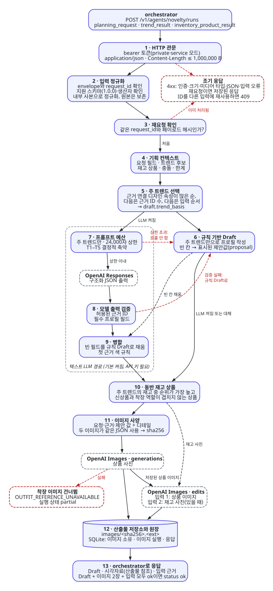

# 아키텍처

novelty 서비스는 기획 요청과 트렌드·재고 결과를 받아 근거가 연결된 신상품 기획안(Draft)을 쓰고, 설정하면 상품·착장 이미지를 만든다. 이 문서는 서비스의 경계, 구성 요소, 요청 한 번의 처리 순서를 설명한다.

## 시스템 안에서의 위치

```text
사용자 질문 → orchestrator
  → trend      (트렌드와 근거)
  → inventory  (트렌드별 기존 재고 상품)
  → novelty    (이 서비스: 신상품 Draft와 이미지)   ← POST /v1/agents/novelty/runs
  → research   (Draft의 상품 프로필로 판매·시장 검토)
  → orchestrator가 결과를 모아 기획서를 만든다
```

- novelty는 다른 서비스를 직접 부르지 않는다. orchestrator가 트렌드와 재고 결과를 모아 한 요청으로 보낸다.
- novelty는 research 결과를 입력으로 받지 않는다. orchestrator가 novelty의 `product_profile`로 research 요청을 만든다.
- 기획서(planning board) 이미지는 orchestrator가 만든다. novelty는 응답의 `planning_board`를 늘 `null`로 둔다.
- novelty는 업무 데이터베이스에 접속하지 않는다. 로컬 SQLite는 생성 이미지의 소유와 응답 재사용만 기록한다.

## 구성 요소

| 패키지 | 역할 | 주요 모듈 |
|---|---|---|
| `adapters/` | 입력 envelope와 세 입력의 스키마·생산자·request ID 검증, trend 결과의 내부 사본 정규화 | `draft_inputs.py` |
| `domain/` | 기획 컨텍스트, 주 트렌드 선택, 규칙 기반 Draft, Draft 모델과 검증, 프롬프트 예산, 동반 재고 상품 선택, 착장 역할 규칙 | `context.py`, `trend_basis.py`, `generator.py`, `concept.py`, `prompt_budget.py`, `outfit_companion.py`, `styling.py` |
| `sources/` | OpenAI Responses API 텍스트 제공자 | `openai_text_provider.py` |
| `workflows/` | 입력 → Draft 분석, 텍스트 LLM 생성과 검증·대체, 이미지 제공자, 산출물 저장소와 원장 | `planning_draft.py`, `text_concept_generation.py`, `image_generation.py`, `draft_artifacts.py` |
| `server/` | 표준 라이브러리 HTTP 서비스, 응답 조립, 이미지 호출 순서 | `app.py` |

도메인 코어는 표준 라이브러리만 쓰고 HTTP나 저장소에 의존하지 않는다([ADR 0001](decisions/0001-standard-library-core-with-a-generator-port.md)).

## 요청 한 번의 처리 순서

<picture>
  <source media="(prefers-color-scheme: dark)" srcset="diagrams/request-flow-dark.svg">
  
</picture>

1. **HTTP 관문**: `private`·`service` 모드에서는 bearer 토큰을 확인한다. `application/json`만 받고, `Content-Length`가 1,000,000바이트를 넘으면 본문을 읽지 않고 `413`을 보낸다([T-HTTP-01](troubleshooting.md#t-http-01)).
2. **입력 정규화**: envelope에는 `contract_version`, `request_id`, `input`만 있어야 하고 `input`에는 세 입력만 있어야 한다. 지원하는 스키마 버전과 생산자인지, request ID가 모두 같은지 확인한다. 원본 입력은 그대로 보관하고, 분석에는 내부 사본을 쓴다.
3. **재요청 확인**: 같은 request ID와 같은 페이로드 해시면 저장된 응답을 그대로 돌려준다. 같은 ID에 다른 페이로드면 `409 REQUEST_ID_REUSED`다.
4. **기획 컨텍스트**: 요청 필드, 트렌드 후보, 재고 상품을 모으고 충돌과 한계를 기록한다.
5. **주 트렌드 선택**: 쓸 수 있는 후보 중 근거가 연결된 디자인 속성이 가장 많은 트렌드를 고르고 `draft.trend_basis`에 남긴다([ADR 0002](decisions/0002-one-primary-trend-per-draft.md)).
6. **규칙 기반 Draft**: 주 트렌드만으로 프로필과 문장을 만든다. 입력이 다루지 않는 필드는 표시된 제안값(`proposal`)으로 채운다.
7. **프롬프트 예산**(텍스트 LLM을 쓸 때): 데이터가 24,000자를 넘으면 정해진 단계로 줄인다. 그래도 넘으면 모델을 부르지 않는다([ADR 0003](decisions/0003-deterministic-prompt-budget.md)).
8. **모델 출력 검증**: 구조화 JSON 스키마, 이 요청 안의 근거 ID만 인용했는지, 필수 프로필 필드를 채웠는지 확인한다. 하나라도 어긋나면 규칙 기반 Draft로 대체한다.
9. **병합**: 모델이 비운 필드를 규칙 Draft로 채우고, 색이 여럿인 주 트렌드에는 첫 근거 색 규칙을 적용한다.
10. **동반 재고 상품**: 주 트렌드의 재고 중 순위가 가장 높고 신상품과 착장 역할(상의·하의)이 겹치지 않는 상품을 고른다.
11. **이미지 사양**: 프로필에서 출처가 `user_requested`, `evidence_observation`, `proposal`인 값과 디테일만 골라 JSON 하나로 만들고 SHA-256을 남긴다.
12. **이미지**(설정했을 때): 상품 이미지를 만든 뒤, 저장된 상품 이미지(그리고 있으면 재고 사진)를 편집해 착장 이미지를 만든다. 동시에 한 쌍만 처리하고 자동 재시도는 없다([ADR 0004](decisions/0004-sequential-images-and-a-replay-ledger.md)).
13. **응답**: Draft, 시각자료 참조, 입력 근거, 생성 메타데이터를 돌려주고 원장에 저장한다. Draft와 이미지 두 장이 만들어지고 상위 입력이 모두 `ok`이면 `status`는 `ok`다([ADR 0005](decisions/0005-deliverable-based-status.md)).

모든 상자와 화살표의 코드 근거는 [diagrams/CLAIMS.md](diagrams/CLAIMS.md)에 있다.

## 동시성과 자원

- `ThreadingHTTPServer`가 요청마다 스레드를 쓴다.
- 이미지 호출은 프로세스당 한 쌍만 동시에 처리한다. 다른 요청이 이미지 처리 중이면 그 요청의 두 visual은 `IMAGE_CAPACITY_BUSY`로 실패하고, 재시도는 새 request ID로 한다.
- 이미지 호출은 별도 스레드 풀에서 돌고, 호출마다 `NOVELTY_DRAFT_IMAGE_TIMEOUT_SECONDS`(기본 180초, 5–300초)에 여유 10초를 더해 기다린다.

## 신뢰 경계

- 요청 데이터와 상위 결과는 모두 신뢰하지 않는 데이터로 다룬다. 모델에는 길이를 제한한 JSON 데이터로만 넣는다([prompt-safety.md](prompt-safety.md)).
- 모델에는 도구·파일·네트워크 권한을 주지 않는다.
- 로그에는 프롬프트, 이미지 바이트, 입력 페이로드, 인증 정보를 남기지 않는다.

## 관련 문서

- [Draft 데이터 모델](draft-model.md)
- [운영](operations.md)
- [데이터 카드](data.md)
- [HTTP 계약](../contracts/http-handoff.md)
- [트러블슈팅](troubleshooting.md)
