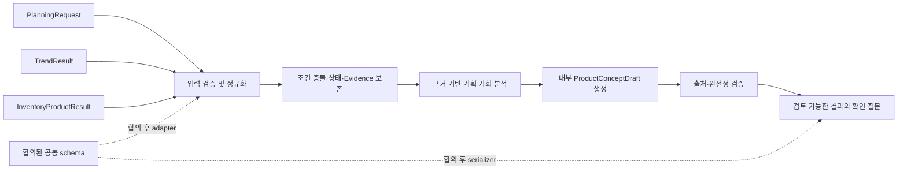

# New Product Planning Agent 향후 작업 설계

- 상태: 제안 · 팀 통합 및 공통 계약 합의 전
- 범위: VOGUE 3번 New Product Planning Agent
- 기준일: 2026-11-05
- 기준 문서: Notion Project Overview, Project Workflow, 저장소 분리 협업 가이드, API Design, Data & Knowledge, Experiments & Evaluation, Architecture & Technical Design, GitHub Workflow

## 1. 설계 원칙

1. 5단계 파이프라인의 **3번 에이전트만** 구현합니다. 4번 Product Feasibility Agent는 이후 별도 저장소, 5번 Planning Review Agent는 별도 담당 경계입니다.
   - Project Workflow의 `VOGUE 기획 파이프라인` 토글은 경쟁상품·판매량 분석이 포함된 검토용 과거 초안이므로 구현 기준으로 쓰지 않습니다.
2. 확정 흐름은 `PlanningRequest + TrendResult + InventoryProductResult → ProductConcept`입니다.
3. 경쟁상품/외부상품 시장 조사와 판매량 분석은 범위에서 제외합니다. 현재 재고는 기준 시점 스냅샷이며 수요·판매 추세의 대리 지표가 아닙니다.
4. 입력에서 확인한 사실, 해석, 제안, 가설, 미확정을 나눕니다. 고객 선호·시장 수요·가격·원가·생산 가능성을 만들어 사실처럼 쓰지 않습니다.
5. 임시 구현 모델은 공통 계약이 아닙니다. 별도 `vogue-contracts` 저장소나 이 저장소 단독 기준 계약을 만들지 않습니다.
6. 현재는 외부 모델, 데이터 원천, API, 저장소 연결을 추가하지 않습니다. 팀 결정 후 얇은 어댑터를 연결합니다.
7. 평가 수치와 성능 주장은 승인된 입력과 실제 측정 전까지 기록하지 않습니다.

## 2. 현재 기준선

| 영역 | 현재 상태 | 남은 핵심 공백 |
| --- | --- | --- |
| 입력 컨텍스트 | 세 입력의 request/schema 일치, 차원 충돌, 입력별 상태·Evidence·제한 보존 | 개별 결과의 원문 필드 검증, 비교 가능한 기간·상품 ID·단위 정의 |
| 콘셉트 초안 | Python 표준 라이브러리 기반 결정적 초안 스캐폴드 | 트렌드 근거와 자사 상품 속성의 관계에서 기획 기회를 분석하는 로직 |
| 출처 검사 | Evidence ID 존재 여부, 일부 claim/attribute 출처 형식 검사 | Evidence 권한·최신성·의미적 뒷받침은 입력/별도 평가 영역 |
| 서비스 연결 | 없음 | 공통 계약 확정 후 입력·출력 adapter, 이후 전송/API |
| 데이터 연결 | 없음. upstream 결과만 소비하도록 경계 설정 | Agent 1·2의 합의된 출력 예시와 승인 샘플 |
| 평가 | 합성 데모와 미실행 평가 시나리오 문서 | 자동 회귀 테스트와 승인 데이터 기반 품질 검토 |

현재 동작은 [임시 구현 기본값 ADR](../decisions/adr-0001-provisional-implementation-defaults.md), [설계 제안](new-product-planning-agent.md), [초안 생성 평가 계획](generator-evaluation-plan.md)에 기록되어 있습니다.

## 3. 목표 아키텍처

도메인 코어는 계약 어댑터가 만드는 정규화 입력만 처리합니다. `ProductConceptDraft`는 내부 모델이고, 최종 `ProductConcept` 필드 구조와 공통 응답 envelope는 다섯 저장소의 계약 변경 절차가 끝난 뒤 연결합니다.

## 4. 작업 단계

| 순서 | 작업 | 주요 산출물 | 완료 조건 | 선행 조건 |
| --- | --- | --- | --- | --- |
| 0 | 계약 중립 코어 기반 마련 | 입력 정합성 검사, 내부 draft·출처 검사, 결정적 생성기, 합성 데모 | 현재 브랜치에 반영됨 | 없음 |
| 1 | 충돌 인지형 입력 준비 | 입력 완전성 규칙, 충돌별 사용 가능 필드, 근거·미확정 분리 | 충돌한 시즌/카테고리 등을 제안 사실처럼 사용하지 않고 질문으로 보존 | 계약 없이 진행 가능 |
| 2 | 기획 기회 분석 코어 | `OpportunityFinding` 내부 모델과 분석 규칙 | 트렌드 근거와 자사 상품 속성의 관계를 설명하되 데이터 공백을 수요·상품 공백으로 오해하지 않음 | 1단계, 입력 완전성 메타데이터 필요 |
| 3 | 도메인 회귀 검증 | 단위·상태·출처·충돌 테스트와 합성 fixture | 평가 계획의 핵심 시나리오가 반복 실행 가능하고 실제 0/no_results/error를 구별 | 1·2단계 |
| 4 | 공통 계약 조정 | 다섯 저장소의 동일 계약 파일 변경 PR 묶음 | 경로·버전·파일 내용 일치, 호환성/마이그레이션 검토 완료 | 팀 합의, 관련 레포 접근 |
| 5 | 계약 adapter | 입력 parser/validator, 출력 `ProductConcept` serializer | 합의된 schema 예시와 실제 도메인 입력/출력이 양방향 호환 | 4단계 |
| 6 | 서비스 실행 경계 | 선택된 API/전송, 인증, timeout/retry, 설정 | API Design에서 결정한 전송·권한·오류 동작을 문서와 구현에 반영 | 팀 합의, 5단계 |
| 7 | 에이전트 간 통합 | Agent 1·2 결과 연결, 후속 단계 호환 검증 | 부분 결과·오류·Evidence가 손실 없이 전달되고 담당 경계를 넘지 않음 | 5단계; 6단계는 전송 선택에 따름 |
| 8 | 평가 및 릴리스 준비 | 데이터 버전·커밋·평가 설정·결과·제한 | 합성/승인 데이터로 재현 가능하게 평가하고 미측정 항목을 명시 | 3·7단계, 평가 데이터 승인 |

단계 1~3은 공통 API 결정 없이 진행할 수 있습니다. 4단계부터는 계약 변경을 단일 레포에서 먼저 확정하지 않고, 관련 레포 PR을 서로 연결합니다.

## 5. 다음 구현 단위: 충돌 인지형 기회 분석

### 5.1 입력 품질과 사용 가능 범위

- `request_id` 또는 내부 호환 버전 불일치는 현재처럼 결합을 중단하는 입력 오류로 처리합니다.
- `partial`, `no_results`, `error`는 입력 슬롯별로 유지합니다. 결과가 비었다고 재고 수량 0을 만들지 않습니다.
- 시즌·시장·채널·카테고리 충돌이 있으면 관련 필드를 확정값으로 승격하지 않습니다. 해당 필드에 의존하는 기회는 미정/검증 필요로 돌립니다.
- 기간·Style/SKU 매핑·단위 기준이 없는 수치는 결합하거나 비교하지 않고 누락 사유를 남깁니다.
- 확인되지 않은 Evidence ID, 이름이 비어 있는 트렌드 후보, 출처 불명의 속성은 사실 claim으로 사용하지 않습니다.

### 5.2 기회 분석 규칙

기회 분석은 외부 시장이나 판매성과가 아닌 전달된 근거만으로 수행합니다.

1. 요청 속성은 사용자 조건으로 보존합니다.
2. Evidence가 연결된 트렌드 속성은 트렌드 입력에서 관찰된 후보로 연결합니다.
3. Evidence가 연결된 자사 상품 속성과 현재 재고는 기존 상품 상태의 관찰로 기록합니다.
4. 트렌드 후보와 자사 상품 속성이 맞는지, 다르거나 빠진 부분이 무엇인지 **입력 자료의 범위 안에서** 정리합니다.
5. 카탈로그 범위/완전성이 확인되지 않으면 “자사 상품에 없다”, “상품 구성이 비었다”라고 단정하지 않습니다. `자료에서 확인되지 않음`과 `실제 부재`를 분리합니다.
6. 재고량은 동시 코디 제안에 참고할 수 있는 스냅샷 정보입니다. 높거나 낮은 수량을 인기·과잉재고·판매속도로 해석하지 않습니다.
7. 분석 결과는 `관찰`, `해석`, `가설`, `제안`, `미확정` 내부 유형으로 보존하고, 핵심 유형마다 근거 ID 또는 검증 질문을 연결합니다.

### 5.3 산출물 경계

새 내부 `OpportunityFinding`이 필요한 경우 최소한 다음 정보를 담습니다. 이 구조는 public schema가 아닙니다.

- 기회 설명과 유형(관찰/해석/가설/제안/미확정)
- 연결된 요청 조건, TrendCandidate, Style/SKU 참조
- 참조 Evidence ID
- 비교 기준(시즌·카테고리·시장/채널, 적용 가능하면 기간·단위)
- 데이터 범위/완전성 상태
- 충돌·제한·추가 확인 질문

초기에는 정렬/우선순위 점수를 만들지 않습니다. 모든 후보를 사람이 검토할 수 있게 반환하고, 정렬이 필요해지면 목적·근거·평가 기준을 별도 결정합니다.

## 6. 테스트와 평가 설계

코드 회귀 테스트와 생성 품질 평가는 구분합니다.

- **도메인 회귀 테스트:** request/schema 불일치, 동일 Agent ID의 두 입력, 각 상태값, 차원 충돌, 복수 요청 속성, Evidence 누락·잘못된 ID, 재고 0과 조회 없음, 원가/가격 미입력.
- **기회 분석 테스트:** 확인된 자사 상품 속성의 중복/보완, 입력 범위가 불완전한 경우, 트렌드와 요청 속성의 충돌, 근거 없는 상품 구성 공백 주장 방지.
- **품질 검토:** MD 검토자가 합성 또는 승인된 입력에 대해 기회 설명의 근거 충실성, 가설 표시, 검토 편의성을 평가합니다. 기준과 검토자 합의 전 점수는 만들지 않습니다.
- **보안/권한 확인:** 입력 제공 단계에서 권한이 확인됐는지 검토합니다. Evidence ID 존재 검사는 라이선스나 실제 접근권한 판정이 아닙니다.

Experiments & Evaluation 원칙에 따라 데이터 버전, 코드 커밋, 평가 설정, 결과와 결론을 함께 기록합니다. 테스트 실행 여부를 성능 결과로 과장하지 않습니다.

## 7. 팀 합의가 필요한 시점

아래 결정 전에는 대체 가능한 내부 설계만 진행합니다.

| 합의 항목 | 필요한 시점 | 통합 영향 |
| --- | --- | --- |
| `ProductConcept` nesting, 필수/null 필드, 다중 콘셉트 허용 | 계약 adapter 시작 전 | serializer, consumer와 예시 payload |
| 공통 Evidence/claim 유형, 권한 상태와 ID namespace | 계약 adapter 시작 전 | provenance mapping과 검증 규칙 |
| 상태·오류 상세 코드 및 에러 입력에서 draft 지속 여부 | 통합 실행 전 | 응답 status, 부분 결과 정책 |
| 공통 계약 경로·버전·동일 반영 절차 | 계약 변경 PR 시작 전 | 다섯 레포 연결 PR과 migration |
| 언어/운영 런타임 및 API 전송 | 서비스/API 구현 전 | packaging, deployment, auth, timeout/retry |
| LLM/외부 모델 도입과 허용 입력 | 모델 연결 전 | 개인정보·비용·재현성·평가 설계 |
| Agent 1·2의 승인된 대표 입력/응답 | 통합 fixture 작성 전 | 현실적인 adapter와 상호운용 검증 |

팀이 당장 결정하기 어려운 항목은 현재 임시 ADR대로 진행합니다. 임시 기본값은 Python 내부 모델, 결정적 생성기, 무상태 처리이며 운영 합의로 간주하지 않습니다.

## 8. 이 에이전트가 하지 않을 일

- 자체 트렌드/상품/재고 데이터베이스 또는 인덱스를 소유·복제하지 않습니다.
- 경쟁상품·외부상품 조사와 판매량 분석을 추가하지 않습니다.
- 원가·마진·생산·조달·고객 피드백 분석을 중복 구현하지 않습니다.
- MD 검토 기록, 최종 기획안 렌더링/승인, 가격 확정, 발주, 외부 공개를 수행하지 않습니다.
- 계약 미정 상태에서 이 저장소의 모델을 여러 레포의 기준 schema라고 부르지 않습니다.

## 9. 협업 산출물과 Git 흐름

- 도메인 단계마다 합성 fixture, 입력/출력 설명, 제한사항을 변경에 포함합니다.
- 공통 계약 PR은 해당 변경을 쓰는 각 저장소에서 같은 버전과 내용으로 준비하고 상호 연결합니다.
- PR 설명에는 단계 책임, 바뀐 모델/근거 처리, 상태별 동작, 자동 테스트 결과, 아직 실행하지 않은 검증을 구분합니다.
- 브랜치 보호와 CI 정책은 GitHub Workflow에서 아직 TBD이므로 저장소 실제 정책을 확인한 뒤 적용합니다.
- 승인된 팀 규칙이 생기면 이 문서와 임시 ADR의 상태를 함께 갱신합니다.

## 참고 문서

- [Project Overview](https://app.notion.com/p/40d3269b1acd809c98c5dc5de4f61d24)
- [Project Workflow](https://app.notion.com/p/40f3269b1acd81378143f35b599ef9a0)
- [저장소 분리 협업 가이드](https://app.notion.com/p/40e3269b1acd81489fecc1052e033b54)
- [API Design](https://app.notion.com/p/40d3269b1acd818bb6eaecb6d1db5f8b)
- [Data & Knowledge](https://app.notion.com/p/40d3269b1acd81a28e69c991870f7fbd)
- [Experiments & Evaluation](https://app.notion.com/p/40d3269b1acd81ac80eae832d87226bd)
- [Architecture & Technical Design](https://app.notion.com/p/40d3269b1acd81b8b16fce9010a37a5e)
- [GitHub Workflow](https://app.notion.com/p/40d3269b1acd81a88e21f6c534604e70)
