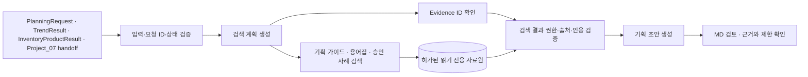

# Project_06 기획 전용 KG/RAG 설계

- 상태: 검색 경계·초안 API 연결 구현, 운영 자료원 미연결
- 범위: 사용자 요청, Trend Agent 결과, 상품·재고 Agent 결과를 사람이 검토할 신제품 기획 초안으로 묶는 검색 보조 기능
- 책임 경계: 판매·시장 원천 검색, 집계 및 해석은 Project_07 소유
- 관련 문서: [데이터 출처·Evidence 경계](data-source-and-evidence-plan.md), [TrendBatch 기반 상품기획 설계](trend-batch-kg-rag-product-planning.md), [Project_07 handoff](project-07-handoff-proposal.md)

## 1. 목적과 비목표

RAG는 기획 담당자가 제공한 입력을 보강할 수 있는 허가된 내부 자료를 찾아, 제품 제안의 기준과 출처를 보여주는 데 사용한다. 검색 결과는 제안과 검증 질문을 만드는 참고 근거이며, 사실 여부·사업 타당성·수요를 자동 판정하지 않는다.

이 설계에서 다루는 검색은 다음 세 가지다.

1. **전달된 Evidence 확인:** 상위 입력의 Evidence ID와 연결된 허가 자료에서 해당 근거의 제목·발췌·위치를 찾는다.
2. **상품기획 기준 검색:** 승인된 브랜드 디자인 가이드, 카테고리·속성 용어집, 소재·구성 기준을 찾아 제안이 내부 기준에 맞는지 검토한다.
3. **과거 기획 사례 검색:** 접근 권한과 재사용 조건이 확인된 MD 검토·승인 기획안에서 유사한 시즌·카테고리 사례를 찾는다. 과거 사례는 참고 예시로만 사용한다.

RAG는 판매 원장, 경쟁사 매출, 시장 규모, 가격·원가, 수요 예측을 검색·집계하거나 새로 분석하지 않는다. 이 정보가 필요하면 Project_07 결과를 소비한다. 트렌드나 상품·재고 원천도 Project_06이 직접 조회하지 않는다.

## 2. 현재 구현과 설계 차이

`src/vogue_npp/domain/retrieval.py`에는 기술 중립 `KnowledgeRetriever` 포트, `RetrievalQuery`, `EvidenceRef`, `KGPath`, 그리고 검색이 수행되지 않았음을 명시하는 `EmptyKnowledgeRetriever`가 있다. 현재 질의는 검색 목적·scope·allowlist·query plan 버전·exact terms·후보/최종 한도를 추적하며, TrendBatch 기획 흐름에서 선택적으로 호출한다. `sources/hybrid_retriever.py`에는 lexical/dense adapter 결과를 RRF로 병합하는 backend-neutral orchestrator가 있지만 실제 BM25/vector 인덱스 adapter는 없다. `sources/synthetic_corpus_retriever.py`는 명시 호출형 합성 데이터 테스트/demo에만 사용한다.

기획 초안 API는 retrieval workflow를 호출해 경로별 상태와 허가된 참고 자료를 응답에 보존한다. `RuleBasedConceptGenerator`는 검색 결과를 새로운 상품 사실로 만들지 않는다. 허가된 인용문은 MD 검토 섹션과 선택 이미지 프롬프트의 참고 자료로 전달한다. 기본 `RetrievalSourcePolicy`는 비어 있어 모든 경로가 `not_configured`이며, 실제 문서 저장소·BM25/vector 인덱스·그래프 저장소·권한 확인 adapter는 연결되어 있지 않다. 테스트는 합성 fixture 및 fake lexical/dense adapter만 사용한다.

## 3. 책임 경계와 데이터 흐름



검색은 입력 정합성 검사 뒤, 초안 작성 전에 실행한다. 검색 결과는 별도 `PlanningKnowledgeContext`에 담아 초안 생성기에 전달한다. 기존 네 입력의 원문·상태·Evidence를 대체하거나 수정하지 않는다. 검색 결과를 얻지 못하거나 실패해도 유효한 입력으로 제한된 초안을 만들고, 검색 상태와 제한을 기록한다.

### 검색 경로

| 경로 | 질의 seed | 허용 대상 | 결과의 용도 |
|---|---|---|---|
| 명시 Evidence 확인 | 요청·트렌드·재고·Project_07 payload에 포함된 Evidence ID | ID 확인용으로 승인된 source resolver | 원 Evidence의 제목, 발췌, locator 및 권한 상태 확인 |
| 기준 문서 검색 | 시즌, 카테고리, 요청 속성, Evidence가 있는 트렌드 속성 | 브랜드 가이드, 카테고리·속성 사전, 승인된 제품 기준 | 제안 속성·정의의 내부 기준 대조 |
| 과거 기획 사례 검색 | 시즌·카테고리·채널·상품 역할·검증된 디자인 속성 | 재사용이 허용된 과거 MD 기획 문서 | 유사 사례와 차이, 확인 질문 제안 |
| 분류 관계 검색 | 카테고리 ID, 역할, 속성 용어 | 승인된 taxonomy 및 KG 관계 | 용어 정규화, 제품 역할·속성 관계 설명 |

각 검색 경로는 독립적인 상태와 제한을 반환한다. 기본 설정은 경로를 실행하지 않는 `not_configured`다. 한 경로의 실패가 다른 정상 경로의 결과를 무효화하지 않는다.

## 4. Project_07 판매·시장 Evidence 처리

Project_07의 payload에 finding, observation, Evidence ID, scope와 limitation이 포함되면 Project_06은 전달값을 그대로 보존하고 기획 맥락으로 표시한다. 이 사실만으로 Project_06이 판매 데이터를 다시 검색하거나 분석할 수 있는 권한이 생기지는 않는다.

Evidence 원문이 필요한 경우에는 다음 조건을 모두 만족하는 선택형 `UpstreamEvidenceResolver`만 허용한다.

- Project_07이 승인한 읽기 전용 API 또는 명시된 인계 자료만 사용한다.
- 질의는 해당 요청 payload에 실제 포함된 Evidence ID로 제한한다. 시장 전체나 다른 제품을 대상으로 검색하지 않는다.
- resolver가 반환하는 인용문·출처·기간·단위·분석 범위·권한 상태를 그대로 보존한다.
- Project_06은 원천 판매 행을 가져오거나 지표를 재계산하지 않는다. 새 시장 finding, 전망 또는 수요 주장을 생성하지 않는다.
- 공유 권한이나 계약이 확정되지 않은 동안 이 resolver는 연결하지 않는다. ID가 해석되지 않으면 payload의 기존 설명만 사용하고 “Evidence 원문 미조회”로 표시한다.

이 경로는 상위 분석의 근거를 설명 가능하게 하는 조회이지 판매·시장 RAG 기능이 아니다. 판매 원천 검색과 분석이 필요하면 Project_07에서 수행하고 결과를 handoff로 전달한다.

## 5. 인덱스와 문서 메타데이터

인덱스 구축·갱신과 원문 보관은 원천 소유자가 담당한다. Project_06 adapter는 허용된 읽기 인터페이스를 사용하며, 임의 URL 크롤링이나 원천 파일 복사를 하지 않는다.

검색 가능한 문서·청크는 최소한 다음 메타데이터를 제공해야 한다.

| 필드 | 의미 |
|---|---|
| `document_id`, `chunk_id` | 문서와 검색 조각의 안정적인 식별자 |
| `source_id`, `source_type`, `source_name` | 원천 및 자료 유형 |
| `evidence_id` | 기존 입력 또는 원천 시스템에서 발급한 근거 식별자. 식별 불가 시 새 ID를 입력 ID처럼 가장하지 않음 |
| `locator` | 페이지, 섹션, 레코드 범위 등 재확인 위치 |
| `published_at`, `observed_at`, `as_of` | 문서 발행·관찰·기준 시점 |
| `season`, `category_id`, `market`, `channel`, `product_id` | 범위 필터용 값. 알 수 없으면 null |
| `permission_status`, `permitted_uses` | 접근 및 기획·보관·인용 사용 권한 |
| `content_hash`, `index_version` | 인용 검증과 검색 재현을 위한 버전 정보 |

승인된 문서라도 사용 권한이 `unknown` 또는 `denied`인 청크는 생성 문맥과 인용에 넣지 않는다. 최신성이 확인되지 않는 문서는 현재 사실 대신 과거 참고 사례로만 분류한다.

## 6. 검색 포트와 결과 모델 방향

현재 포트를 대체하지 않고 점진적으로 확장한다. 질의에는 검색 의도를 명시해 각 adapter가 허용 범위와 의미를 좁힐 수 있게 한다.

```text
RetrievalQuery
  request_id
  purpose: evidence_lookup | planning_reference | precedent | taxonomy
  query_terms
  evidence_ids
  season / category_ids / market / channel
  allowed_source_ids / allowed_source_types
  limit

RetrievalResult
  status: not_configured | ok | partial | no_results | error
  evidence[]
  kg_paths[]
  limitations[]
  index_version / retrieval_run_id
```

`EvidenceRef`는 현재 `evidence_id`, `source_id`, `locator`, `quote`, `source_date`, `access_status`, `verified`를 유지한다. 구현 시 필요에 따라 `source_type`, `permission_status`, `permitted_uses`, `content_hash`, `matched_by`, `retrieval_run_id`를 추가할 수 있다. 의미 검색 점수는 관련도 정렬용으로만 보존할 수 있으며, 트렌드 강도·상품 성과·구매 확률로 해석하지 않는다.

요청 ID, Evidence ID, limit, allowlist는 포트 경계에서 검증한다. 범용 문자열 검색을 허용하더라도 adapter가 scope 필터를 강제하고, 각 검색 결과가 어떤 질의 목적에 반환되었는지 감사할 수 있어야 한다.

## 7. 생성기 사용 규칙

- 검색된 관찰은 `evidence_observation`, 과거 사례에서 도출한 적용 가능성은 `interpretation` 또는 `hypothesis`, 신규 디자인 선택은 `proposal`로 분류한다.
- 검색 문서가 제품 속성의 근거가 될 때 해당 속성 claim에만 Evidence ID를 연결한다. 문서가 콘셉트 전체나 시장 성공을 지지한다고 표현하지 않는다.
- 사용자 요청, 상위 Agent 관찰, 검색 관찰, 생성기 해석·제안은 별도 출처로 표현한다.
- 같은 문서에서 여러 검색 결과가 나와도 중복 Evidence ID를 제거하되, 각 claim과의 연결은 보존한다.
- 빈 검색 결과를 “해당 속성이 없음”이나 “기회가 있음”으로 해석하지 않는다. 인덱스 범위와 검색 제한을 명시한다.
- 검색 결과가 없는 경우에도 검색이 실행되지 않은 `not_configured`, 실행 후 결과가 없는 `no_results`, 일부 경로만 성공한 `partial`, 실패한 `error`를 구분한다.

## 8. 실패·보안·운영 원칙

| 상태 | 초안 동작 |
|---|---|
| `not_configured` | 검색을 하지 않았다고 표시하고 입력 기반 초안을 계속 작성 |
| `no_results` | 검색 범위에서 결과가 없었다고 표시. 사실의 부재로 추론하지 않음 |
| `partial` | 성공한 경로만 사용하고 실패·제외된 경로와 제한을 표시 |
| `error` | 검색 내용을 사용하지 않고 유효한 원 입력으로 초안을 계속 작성 |
| 권한 미확인/거부 | 해당 문서·발췌를 생성기에서 제외하고 안전한 제한만 기록 |

검색 로그에는 query 원문, API key, 민감한 요청 문구를 기본 저장하지 않는다. 재현성이 필요하면 request ID, query plan 버전, source snapshot ID, index version, 반환 Evidence ID, 안전한 상태 코드만 보존한다. 원문/검색 결과 보존·삭제 기간과 접근 감사는 저장소 연결 전에 자료 소유자와 합의한다.

## 9. 평가와 출시 단계

1. **계약·fixture:** `data/fixtures/planning_rag/synthetic_corpus.json`의 합성 문서로 검색 결과와 Evidence 연결을 검증한다. 명시적으로 호출하는 `SyntheticCorpusRetriever`는 정확 Evidence ID 조회, 목적별 타입 제한, source·시즌·카테고리·시장·채널 필터, 합성 문서 내 결정적 키워드 정렬을 제공한다. 기본 초안 경로에는 연결하지 않으며 이 자료는 실제 회사 문서, 승인된 정책 또는 시장 사실이 아니다.
2. **내부 가이드 adapter:** 브랜드 가이드·taxonomy의 소유자와 허용 범위가 정해진 뒤 읽기 전용 검색을 연결한다.
3. **기획 사례 adapter:** 재사용 가능한 과거 기획 문서와 승인 상태, 민감도, 보존 기간을 합의한 뒤 연결한다.
4. **선택 Evidence resolver:** Trend/Stock/Project_07 각 소유자가 안정된 Evidence lookup을 제공할 때만 연결한다. Project_07 경로는 별도 계약 승인 전 비활성 상태로 둔다.

합성 corpus는 과거 기획 예시, 디자인 가이드, taxonomy, 상위 입력 Evidence 스냅샷과 scope가 다른 문서, 권한이 `unknown`·`denied`인 문서를 포함한다. 로컬 synthetic adapter는 외부 자료원에 접근하지 않고 모든 문서의 합성 표시와 Evidence ID 중복 여부를 검사한다. 운영 corpus로 대체하기 전 자료 소유자 승인, 사용 목적, 보존·삭제, 접근 감사, 인덱스 갱신·버전 관리 및 cross-project 계약을 합의해야 한다.

평가 지표는 근거 ID 회수율, 인용 정확도, claim-to-evidence 정밀도, scope 필터 준수율, 미허가 문서 차단율, 검색 실패 시 안전한 abstention 비율, 생성 초안에서의 근거 없는 사실 주장 비율로 둔다. top-k relevance 점수만으로 제품 제안 품질을 평가하지 않는다. 승인된 대표 질의와 사람이 확인한 Evidence 정답 집합 없이 운영 인덱스를 활성화하지 않는다.

## 10. 구현 수용 기준

- 현재 네 입력의 상태·request ID·Evidence 원문을 검색 결과가 덮어쓰지 않는다.
- RAG 실행 여부와 검색 경로별 결과 상태가 응답·기획서 제한사항에 나타난다.
- 모든 검색 기반 사실 claim에서 source, locator 또는 Evidence ID를 추적할 수 있다.
- 권한 미확인 문서와 허용 범위 밖의 자료는 모델 프롬프트에 들어가지 않는다.
- 검색 실패·미구성·무결과가 서로 구분되고, 각각의 경우에도 유효한 초안을 생성할 수 있다.
- Project_06에 판매 집계, 시장 raw-data 검색 또는 Project_07의 finding 재계산이 추가되지 않는다.
- 의미 검색 점수, 검색량, 과거 판매 수치가 승인되지 않은 사업 점수나 수요 예측으로 바뀌지 않는다.
