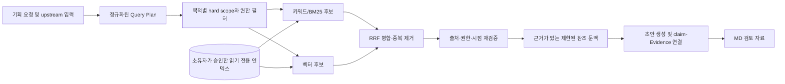

# Project_06 RAG 고도화 설계안

- 상태: 제안
- 범위: 승인된 기획 참고자료 검색 품질·재현성·검증 체계 고도화
- 현재 상태: 내부 검색 포트·초안 연결, 합성 JSON corpus용 결정적 검색 adapter 및 backend-neutral lexical/dense RRF 병합기 구현. 운영 BM25/vector adapter와 인덱스는 미연결
- 책임 경계: 판매·시장 데이터 원천 검색과 분석은 Project_07 소유
- 관련 문서: [현재 RAG 설계](planning-rag-design.md), [데이터 출처·Evidence 경계](data-source-and-evidence-plan.md)

## 1. 목표

기획 요청의 시즌·카테고리·시장·채널·상품 속성과 일치하는 허가된 내부 자료를 찾고, 초안에서 사용된 제안과 참고자료의 출처를 다시 확인할 수 있게 한다. 검색은 검토 가능한 참고 근거를 제공하며, 검색 점수만으로 제품 선택·사업성·수요·고객 선호를 판단하지 않는다.

고도화의 중심은 특정 벡터 DB를 도입하는 것이 아니라 다음 네 가지를 신뢰할 수 있게 만드는 것이다.

1. 자료 권한과 검색 범위를 검색 전에 강제한다.
2. 한국어·영어 용어와 문서 표현 차이를 고려해 후보를 찾는다.
3. 모든 사용 근거를 원문 위치와 시점까지 추적한다.
4. 검색 품질과 권한 필터 준수 여부를 합성 평가셋으로 측정한다.

## 2. 범위와 비목표

### 검색 대상

- 승인된 브랜드 디자인·소재·구성 가이드
- 승인된 상품 taxonomy와 용어 사전
- 재사용이 허가된 과거 상품 기획서와 MD 검토 자료
- 입력 payload에 실제 포함된 요청·트렌드·재고 Evidence ID에 대한 허가된 Evidence 설명 자료

### 비대상

- 판매 원장, 경쟁사 판매, 시장 규모, 가격·원가 원천 검색 및 재집계
- Project_07 finding의 재계산, 점수화 또는 Evidence ID resolver 구현
- 트렌드 및 재고 원천 시스템 직접 조회
- 허가되지 않은 파일 수집, URL 크롤링, 회사 문서 복제
- RAG 검색으로 사업 승인, 제품 채택, 수요·매출 전망 자동화

Project_07 handoff는 전달된 payload 그대로 보존한다. Project_07 Evidence 원문 조회는 소유자 승인과 공유 계약 전에는 비활성 상태로 유지한다.

## 3. 현재 구현에서 다음 단계

| 영역 | 현재 | 고도화 방향 |
|---|---|---|
| 포트 | `KnowledgeRetriever`, `RetrievalQuery`, `EvidenceRef` | 기술 중립 포트 유지, query plan 버전과 검색 trace 연결 |
| 로컬 검색 | 합성 JSON의 substring 검색, Evidence ID exact match | 데모 용도로 한정. 운영 검색 품질 기준으로 간주하지 않음 |
| 범위 | 목적·source·시즌·카테고리·시장·채널 필터 | 인덱스 및 저장소 접근 계층에서도 필터 강제, 우회 테스트 |
| 순위 | 합성 adapter의 매칭 term 수 | BM25 + dense 후보의 RRF 병합. 필요 시 승인된 reranker를 별도 실험 |
| 권한 | 검색결과에서 authorized·verified·permitted use 확인 | 수집, 검색, 생성 직전 3단계 권한 검증 및 삭제/철회 반영 |
| 청크 | 합성 문서 단위 | 제목·섹션·표 구조를 보존하는 문서 유형별 분할과 locator |
| 평가 | 기능 fixture 테스트 | 사람이 검토한 golden set, retrieval 및 citation 평가와 회귀 기준 |
| 운영 | 외부 자료원 미연결 | 소유자·권한·보존·운영비 확정 뒤 읽기 전용 adapter 선택 |

## 4. 목표 구성



### 경계

- `domain/retrieval.py`는 검색 질의·결과의 내부 포트와 provenance 모델을 소유한다.
- 별도 source adapter가 승인 인덱스에 대한 후보 검색을 수행한다. 인덱스 종류는 규모, 보안, 운영 주체가 결정되기 전 고정하지 않는다.
- `planning_retrieval.py`는 기존 입력으로 query plan을 만들고, adapter 결과를 검증·정리해 `PlanningKnowledgeContext`로 전달한다.
- 초안 생성기는 상위 입력을 수정하지 않고 검색 참고자료를 독립된 섹션으로 소비한다.
- 운영 adapter는 합성 adapter를 상속하거나 합성 데이터를 운영 인덱스에 적재하지 않는다.

## 5. Query Plan

쿼리 생성은 원본 입력을 검색어로 통째로 보내지 않고 허용된 필드를 사용한다. `request_id`는 trace용이며 외부 검색 본문이나 사용자에게 노출할 로그 문자열이 아니다.

```text
PlanningQueryPlan
  query_plan_version
  request_id
  purpose: evidence_lookup | planning_reference | precedent | taxonomy
  evidence_ids                  # evidence_lookup에만, 입력 payload에서 수집
  normalized_terms              # 요청 속성·근거 연결 트렌드 속성·승인 동의어
  season / category_ids / market / channel
  source_ids / source_types      # 서버 policy에서만 주입
  candidate_limit / final_limit
```

요청의 전체 자유 텍스트는 기본 검색에 포함하지 않는다. 별도 query expansion이 승인되더라도 개인정보·기밀정보 제거, 생성된 동의어의 출처 기록, 확장 횟수 제한을 적용한다. 입력이 불충분하면 검색 경로를 생략하거나 넓은 질의를 만들지 않고 `not_configured` 또는 명확한 no-query 사유를 보존한다.

## 6. 검색 처리

### 6.1 Hard filter

후보 검색 전과 결과 검증 시 다음 조건을 모두 적용한다.

- purpose별 source ID와 source type allowlist
- 문서별 `permission_status=authorized`, `verified=true`, `product_planning` 사용 허가
- 명시된 시즌·카테고리·시장·채널 범위. 범위 값이 문서에 없으면 wildcard인지 unknown인지 구분
- `evidence_lookup`은 현재 요청의 upstream payload에 포함된 Evidence ID exact match만 허용
- 최신성, 기획 사례 재사용 승인 상태 및 문서 철회 상태

검색어로 필터 조건을 우회하지 못하게 하며, 권한 확인은 후보 생성 전에 가능한 한 수행한다. 저장소의 접근 제어가 metadata filter를 지원하지 않으면 권한 격리된 index를 분리한다.

### 6.2 하이브리드 후보 검색

1차 운영 adapter는 같은 허가 corpus에서 lexical(BM25) 검색과 dense embedding 검색을 병렬 수행한다. 카테고리·속성 코드, 고유명, 시즌·제품 역할처럼 정확도가 중요한 용어는 lexical 경로를 유지한다. 의미가 유사하지만 표현이 다른 기획 문맥은 dense 경로가 보완한다.

- 후보 생성: 각 경로에서 설정된 top-k를 취득하되 hard filter는 양쪽에 동일하게 적용
- 병합: 초기에는 Reciprocal Rank Fusion(RRF) 같은 rank-based 방법으로 합친다. 점수 단위가 다른 원점수를 직접 더하지 않는다.
- 중복 제거: 동일 `chunk_id` 우선, 필요 시 같은 문서의 인접 청크를 묶는다.
- 재정렬: 필요성이 평가된 이후에만 별도 reranker를 실험한다. rerank score는 관련도 정렬용이며 수요·성과 점수로 사용하지 않는다.
- 결과: 목적별 제한 수와 전체 문맥 토큰 예산 안에서 반환한다.

현재 `SyntheticCorpusRetriever`의 substring 점수는 fixture 동작을 재현하는 데만 사용한다. 이를 운영 relevance 점수나 자연어 이해 기능으로 표현하지 않는다.

### 6.3 청킹·인덱싱

문서 소유자 또는 승인 ingestion job이 문서 구조를 보존해 청크를 만든다.

- 기획서: 문서 요약, 제품 콘셉트, 속성/구성, 검토 의견을 섹션별로 분할. 승인 상태와 시즌 보존
- 가이드: 규칙 단위로 분할하고 상위 섹션 제목을 함께 저장
- taxonomy: 관계 단위 및 버전으로 저장. 그래프 조회가 필요할 때만 `KGPath` 반환
- 표: 행·열 헤더를 텍스트에 함께 유지하고 단위·기준 시점을 같은 청크에 둠
- 긴 문서: 제한된 overlap을 두되 중복 Evidence를 추적
- 모든 인덱스 레코드: `document_id`, `chunk_id`, `source_id`, `source_type`, `evidence_id`, locator, 날짜·범위, 권한, 승인 상태, `content_hash`, `index_version` 보존

Project_06은 승인되지 않은 원본을 별도 저장하지 않는다. 삭제·권한 철회 이벤트가 색인과 캐시에 반영될 수 있는 운영 책임자를 둔다.

## 7. Evidence와 생성 문맥

검색 결과는 `PlanningKnowledgeContext`에 격리한다. 초안 claim은 다음 provenance class를 갖고 사실과 제안을 섞지 않는다.

| Claim class | 출처 예 | Evidence 연결 규칙 |
|---|---|---|
| user request | 기획 입력 | 사용자 요청으로 표시, 문서 검색 근거로 위장 금지 |
| upstream observation | trend/stock/Project_07 payload | 전달된 Evidence ID와 상위 상태 유지 |
| retrieved reference | 가이드·taxonomy·과거 기획 | 해당 인용과 직접 연결되는 항목에만 ID 연결 |
| interpretation / hypothesis | 입력과 참고자료의 기획 해석 | 근거와 추론을 별도 표시하고 검증 질문 제시 |
| proposal | 신규 디자인 제안 | 제안으로 명시, 과거 자료가 현재 시장 사실인 것처럼 주장 금지 |

프롬프트에는 허가된 최소 인용문, 제목, locator, 시점, Evidence ID, 자료 유형과 “과거 참고/가이드” 분류만 전달한다. 전체 문서나 검색 결과 전체를 넣지 않는다. 검색 문서는 prompt injection을 포함할 수 있는 비신뢰 데이터로 취급하며, 문서 내 지시문은 실행 지침이 아니라 인용 대상 텍스트로만 처리한다.

## 8. 결과 상태와 오류 격리

각 purpose 결과는 기존 상태를 유지한다.

- `not_configured`: adapter 또는 허용 source 설정이 없거나 해당 경로에 유효한 query가 없음. 사유를 별도 limitation으로 기록
- `no_results`: 검색은 실행됐으나 hard filter 및 검색 조건 안에서 결과가 없음
- `ok`: 허가·검증된 결과가 있음
- `partial`: 일부 경로 실패, 후보 제외, 권한 확인 불가 또는 일부 처리만 완료
- `error`: 해당 route가 실패. 실패 route의 evidence는 전부 버림

BM25/vector 중 한 경로만 성공하면 다른 경로의 오류를 limitation에 남기고 허가 결과를 계속 쓸 수 있다. 모든 adapter 응답은 반환 전 재검증한다. DB timeout, embedding outage, 잘못된 metadata가 전체 초안 생성을 중단시키지 않는다.

## 9. 모델 확장 제안

기존 포트를 점진 확장하며 필요성이 입증되기 전에는 public/shared wire contract를 만들지 않는다.

```text
RetrievalQuery
  query_plan_version
  purpose / request_id
  normalized_terms / exact_terms / evidence_ids
  season / category_ids / market / channel
  allowed_source_ids / allowed_source_types
  limit / filters

EvidenceRef
  document_id / chunk_id / evidence_id
  source_id / source_type / source_name
  locator / quote / source_date / as_of
  permission_status / permitted_uses / verified
  content_hash / index_version / matched_by

PurposeRetrieval
  purpose / status / evidence[] / kg_paths[]
  limitations / retrieval_run_id / index_version
```

`score`를 보존해야 할 경우 `retrieval_score`처럼 검색 정렬 목적임을 명확히 하고 draft claim·제품 점수와 분리한다. 상위 입력과 RAG 결과는 schema version과 provenance가 달라도 독립 슬롯으로 유지한다.

## 10. 평가 전략

합성 fixture를 시작점으로 하고, 운영 연결 전 회사 자료를 복사하지 않은 승인된 비민감 평가 세트를 자료 소유자와 별도로 구성한다. 각 query에 목적, scope, relevant Evidence ID, 금지 문서, 허용 claim, 기대 상태를 기록한다.

| 평가 항목 | 측정 |
|---|---|
| 회수율 | Evidence Recall@k, 목적별 Recall@k |
| 순위 품질 | MRR 또는 nDCG@k, 목적별로 분리 |
| 인용 품질 | claim-to-evidence precision, quote/locator 정확성 |
| 권한·범위 | 미허가 반환 0건, 잘못된 scope 반환 0건 |
| 안전한 실패 | 검색 오류·빈 결과 때 초안 지속 및 무근거 주장 없음 |
| 재현성 | query plan, corpus snapshot, index version으로 동일 결과 추적 |
| 운영성 | latency, timeout, 색인 지연, 삭제·권한 철회 반영 시간 |

검색 관련도 평가는 상품 성공이나 기획 품질 평가를 대체하지 않는다. 기준 세트의 정답은 MD 또는 자료 소유자가 확인해야 한다.

## 11. 단계별 구현 순서

### Phase 0 — 현재 합성 RAG 기준선

- 합성 corpus와 deterministic adapter를 demo/test 전용으로 고정
- 검색 목적, 권한, scope, Evidence 연결 golden tests 보강
- 기존 요청 payload와 Project_07 handoff 불변 테스트 유지

### Phase 1 — 검색 계약·계측

- QueryPlan과 검색 trace 버전 정의
- 결과 메타데이터 검증, content hash, index snapshot 추적 강화
- synthetic 평가 runner 및 검색/인용 지표 리포트 구현
- 허용 source 목록이 없으면 명시적으로 not_configured 처리

### Phase 2 — 승인된 내부 자료 소스 1종

- 가이드 또는 taxonomy 중 소유자·권한·보존이 합의된 한 source만 read-only 연동
- 검색 전 권한 필터와 반환 후 권한 재검증
- 별도 corpus snapshot, ingestion 변경 감지, 삭제/권한 철회 테스트

### Phase 3 — 하이브리드 검색

- backend-neutral `HybridKnowledgeRetriever`가 fake lexical/dense 결과를 RRF 병합하고 상태·provenance·KG path를 보존하는 동작을 검증
- 운영 단계에서 동일 승인 corpus에 BM25와 dense candidate adapter 연결. 현재는 두 실제 candidate adapter가 미구현
- RRF와 lexical-only 기준선을 비교하고 golden set에서 개선 확인
- embedding 모델·버전 변경 시 재색인과 회귀 평가 수행
- 성능/품질 개선 증거 없으면 reranker를 추가하지 않음

### Phase 4 — 재사용 과거 기획 자료

- 승인·보류·기각 상태, 민감도, 재사용 권한을 metadata에서 구분
- 과거 사례가 현재 선호·성과로 일반화되지 않는지 claim audit
- 승인된 자료만 작은 단계로 활성화하고 사용 피드백을 평가셋에 반영

## 12. 운영 개시 전 결정 사항

- 어떤 부서/시스템이 가이드, taxonomy, 기획서의 source owner인가
- 기획 참고, 인용, embedding, 로그 저장의 각각의 사용 권한
- 사용자/역할별 접근 제어와 검색 결과 접근 감사 요구
- 원문을 Project_06에 저장하지 않고 검색할 수 있는 read-only 인터페이스
- 문서 삭제, 권한 철회, 정정, 최신성 갱신 SLA
- 인덱스 운영 주체, 비용, 장애 대응, 백업·보존 정책
- Korean/English embedding 및 개인정보/기밀정보 처리 기준
- 공유 Evidence resolver나 cross-project schema가 필요한 경우 각 에이전트 소유자 승인

위 결정이 끝나기 전에는 합성 adapter 외 운영 source를 활성화하지 않는다.

## 13. 완료 기준

- query plan이 purpose/source/scope allowlist를 항상 전달하고 원문 사용자 query를 불필요하게 검색하지 않는다.
- 권한 미확인·거부, 미승인 과거 사례, Project_07 판매 Evidence는 검색 문맥에 포함되지 않는다.
- 각 검색 claim은 Evidence ID와 locator까지 확인 가능하며 원문 미조회는 그대로 표시된다.
- lexical/vector 경로 실패가 route 상태와 limitation으로 남고 나머지 유효 입력의 초안 생성을 막지 않는다.
- hybrid 검색이 lexical 기준선보다 승인 평가셋에서 개선되며, scope·권한 위반은 발생하지 않는다.
- Project_07 payload는 보존되며 Project_06에 판매 원천 검색·재계산·수요 추정이 추가되지 않는다.
- 검색 점수는 정렬에만 쓰이고 제품 채택, 시장성, 수요, 매출 전망을 자동 판단하지 않는다.
