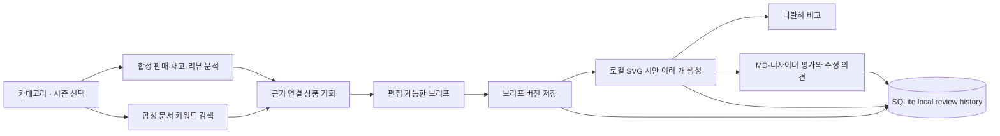

# VOGUE MD Concept Studio 프로토타입

## 실행

프로젝트 루트에서 Python 3.10 이상으로 실행합니다. 외부 Python 패키지 설치는 필요하지 않습니다.

```bash
PYTHONPATH=src python3 -m vogue_npp.prototype.server
```

브라우저에서 `http://127.0.0.1:8765`를 엽니다. 서버는 loopback 주소에만 바인딩합니다. 종료할 때 터미널에서 `Ctrl+C`를 누릅니다.

## Docker Compose 실행

Docker Compose가 설치된 환경에서는 저장소 루트에서 컨테이너를 빌드하고 백그라운드로 시작합니다.

```bash
docker compose up --build -d
```

브라우저에서 `http://127.0.0.1:8765`를 엽니다. 서버는 컨테이너 내부 인터페이스에 바인딩하지만 호스트 포트는 loopback에만 공개됩니다. 종료할 때 `docker compose down`을 실행합니다. 사용자 브리프·시안·평가 SQLite 데이터는 Compose named volume `vogue-local-data`에 남고, 호스트의 H&M `data/processed/hm-personalized-fashion-recommendations/`는 컨테이너 안에 읽기 전용으로 연결됩니다. 이 폴더가 비어 있으면 웹 앱은 실행되고 H&M 결과만 없는 상태로 표시합니다.

이미지 build context에서 `.env`, Kaggle raw ZIP, `data/interim`, `data/processed`, `data/local`은 제외됩니다. 모델 API 키를 Docker 실행 환경에 주입하지 않으며, 현재 프로토타입은 외부 모델 호출을 하지 않습니다.

## 화면 흐름



웹 화면은 합성 데모 기회, 실제 H&M Kaggle 집계, 문서 근거, 브리프 편집, 이미지 시안, 검토 이력으로 나뉜다. 합성 Evidence ID를 누르면 원천 메타데이터와 해당 합성 레코드를 확인할 수 있다. Kaggle 섹션은 `hm_analysis.json` 기반 과거 상품·거래 집계를 별도로 보여주며 synthetic inventory/reviews/trends 또는 brief와 병합하지 않는다. 숫자 집계는 결정적 Python 로직으로 계산하며 문서 검색은 합성 문서 구절의 단순 로컬 키워드 점수다. 생성형 모델은 수치 계산에 사용하지 않는다.

`03 기획·운영 데이터` 섹션은 [상품기획·운영 데이터 계약](planning-operations-data-contract.md)에 정의한 로컬 조회 API를 사용한다. 라인 플랜·마크다운 시나리오·KPI 목표·상세 속성·캠페인은 합성 예시임을 표시하고, 실제 측정값이 연결되지 않은 KPI와 캠페인 결과는 비워 둔다. 실제 Kaggle article 조회에서는 원천 설명만 반환하며 합성 소재·관리·사이즈 속성을 덧붙이지 않는다.

## 데이터와 저장 스키마

입력 fixture는 [`examples/fixtures/prototype_demo.json`](../../examples/fixtures/prototype_demo.json)에 있으며, 모든 값은 합성이다. 실제 Kaggle 다운로드 파일과 별도 경로에서 읽고 섞지 않는다.

| 레코드 | 주요 필드 | 시연 목적 |
| --- | --- | --- |
| `sources` | source ID/name, kind, period, version, permission, as-of | 모든 주장과 수치의 출처·기간·버전·사용 조건을 확인 |
| `products` | Style ID, category, season, color, material, fit, price, size range | 판매 상위 상품의 속성 검토 |
| `sales_profiles` | 주별 units, 할인 비율, return units, stockout days, channel | 판매·매출 계산·할인·반품·품절 신호 비교 |
| `inventory` | Style ID, on-hand/inbound units, lead-time days, snapshot source | 커버 주수와 공급 확인 질문 제시 |
| `feedback` | 무식별 합성 feedback ID, style, date, rating, theme, text | 반복 불만 주제와 브리프 개선 방향 검토 |
| `documents` | 문서 ID/title, source, season/date/version, passages | 트렌드 메모와 KPI/디자인 가이드의 구절 검색 |

서버를 처음 실행하면 사용자 작업 기록은 `data/local/prototype.sqlite3`에 저장된다. 해당 폴더는 Git에서 제외된다.

| SQLite table | 용도 |
| --- | --- |
| `briefs` | 브리프 편집본별 버전, JSON payload, 생성 시각 |
| `variants` | 연결 브리프 버전, 유형, variation, mock prompt, 모델 표기, 생성시각, SVG |
| `evaluations` | 시안/브리프 버전, 다섯 평가점수, 채택 후보, 의견, 저장 시각 |

프로토타입 작업 기록을 초기화하려면 서버를 종료하고 `data/local/prototype.sqlite3`를 삭제한다. 원본 fixture는 유지된다.

## 시연용 분석 정의

- 관측 판매 수량: 가상 주별 units 합계. 기간은 fixture에 기록된 12주이다.
- 매출 참고값: 합성 상품 판매가 × (1 − 합성 할인율) × 판매 수량을 합산한다. 원천 매출이 아니며 가격 전략에 사용하면 안 된다.
- 가중 평균 할인율: 상품별 할인율에 해당 판매 수량을 가중해 계산한다.
- 반품률: 합성 반품 units ÷ 합성 판매 units. 운영 KPI가 아니다.
- 품절 일수: 합성 fixture의 Style별 `stockout_days` 합이며 현재 재고나 실제 품절률을 나타내지 않는다.
- 재고 커버: 현재고 units ÷ 최근 12개 주의 평균 주간 판매 units. 입고 예정량은 식에 포함하지 않으며 발주 권고가 아니다.
- 고객 의견: 낮은 평점(1–3) 표본에서 동일 theme을 묶어 반복 횟수를 표시한다. 대표성이나 인과성을 주장하지 않는다.
- 구색 검토: fixture의 범위 완전성 표기가 있을 때만 기준 문서의 후보 속성과 현재 속성값을 비교한다. 결과는 기회 확정이 아니라 검토 가설이다.

모든 지표 카드와 기회 카드에는 source ID, record ID, 관측 기간 또는 기준 시점, 버전, 권한 표시가 연결된다. 출처 기록을 찾지 못한 문서 검색은 명시적으로 “근거 없음”으로 표시한다.

## 이미지 시안과 피드백

프로토타입에는 [`web/prototype/27ss-light-utility-anorak-imagegen.png`](../../web/prototype/27ss-light-utility-anorak-imagegen.png)에 저장된 ImageGen 실사 콘셉트 1개가 포함되어 있다. 2026-11-05에 기본 Light Utility Anorak 브리프를 참고해 생성했고, 생성 입력과 `OpenAI ImageGen · 세부 모델 버전 미노출`을 시안 메타데이터로 보존한다. 이 결과는 특정 실제 상품/브랜드의 이미지가 아니라 시연용 아이디어 콘셉트다.

앱 안에서 추가 variation을 만들 때에는 외부 모델 대신 코드가 고정 팔레트와 SVG 의류 도형을 그리는 `Local SVG Mock v1`을 사용한다. 상품 단독/착장 콘셉트, 2–4개 variation을 만들며 각 시안은 저장 시점의 브리프 버전, 입력 프롬프트, 모델 표기와 생성 시각을 가진다. ImageGen 사진과 SVG 목업 모두 선택해 이미지와 브리프 버전을 나란히 비교할 수 있다.

각 시안에는 브랜드 적합성, 고객 니즈 반영, 차별성, 가격 검토, 생산 검토를 1–5점으로 입력하고 수정 의견 및 채택 후보 여부를 남길 수 있다. 평가 저장은 자동 학습을 실행하지 않는다. 목업 그림은 실제 소재·색상·핏·생산 가능성을 보증하지 않는다.

## 보안·운영 경계

- 로컬 실행은 loopback에 바인딩하고, Docker Compose는 호스트 loopback 포트만 공개한다. 로그인·팀 권한·감사 통제는 제공하지 않으므로 다른 사용자에게 네트워크로 공유하지 않는다.
- 샘플은 회사 실데이터, 고객 개인정보, 승인되지 않은 기밀 자료를 포함하지 않는다.
- 브라우저에서 외부 이미지·폰트·스크립트 또는 모델 API를 호출하지 않는다.
- 현재 `.env`/LLM 설정은 이 로컬 목업 앱에서 읽지 않는다. 실제 모델 연결 전 서버 secret 관리, 권한, 데이터 최소화, 외부 전송 조건 및 API 실패 상태를 설계해야 한다.
- fixture의 가격/매출·할인·반품·품절 KPI 산식과 각 값은 전부 설명용 가정이다. 조직의 공식 KPI 사전과 검증된 데이터 공급으로 바꾼 후에만 실무 지표로 사용할 수 있다.
- 선택 카테고리와 시즌은 fixture 범위인 Light Outerwear / 27SS 한 쌍이다. 선택 UI는 데이터가 한 범위뿐임을 명시한다. 여러 범위·실제 승인 자료로 확장하는 것은 후속 작업이다.

## 점검 및 제한

이 프로토타입은 사용 흐름과 검토 UX를 시연하기 위한 것이다. 진짜 RAG/벡터 검색, 이미지 모델, SSO/권한, 동시 사용자, 편집 충돌 해결, 문서 업로드, 영구 배포, 품질/성능 평가, 실제 공통 API 계약을 구현하지 않았다. 외부 서비스·내부 데이터가 필요한 영역은 목업으로 남겼다.
