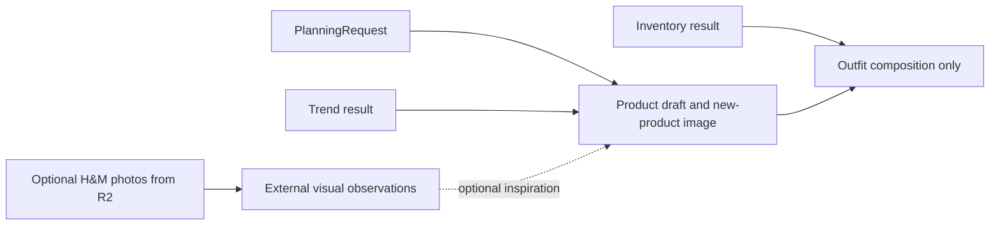

# R2 H&M visual reference

## Runtime boundary

Project_06 no longer queries the synthetic planning workbench, synthetic catalog, synthetic internal rules, taxonomy, or precedent documents. The `/runs` and `/api/planning-draft` paths use only the planning request, trend result, and inventory result. The sales/market result is not part of the planning or product-image inputs.

R2 access remains available for optional H&M image references. The application reads H&M `articles` and `article_attrs` rows to select a small number of category-matched article IDs, then downloads images from the configured R2 image prefix. These are external visual references. They do not support company-policy, material-composition, quality, demand, sales, or customer-preference claims. The generated new-product image prompt does not receive the H&M image or stock item data; stock images are used only in outfit composition.



## Settings

R2 credentials are provided by the service environment. The metadata database object key is `VOGUE_R2_HM_CATALOG_DB_KEY`, falling back to `R2_DB_KEY`. H&M image bytes use `R2_IMAGE_PREFIX/<article_id first 3 digits>/<article_id>.jpg`.

```dotenv
R2_ACCOUNT_ID=
R2_BUCKET=
R2_ACCESS_KEY_ID=
R2_SECRET_ACCESS_KEY=
R2_IMAGE_PREFIX=
VOGUE_R2_HM_CATALOG_DB_KEY=
VOGUE_HM_KAGGLE_IMAGE_ALLOW_PROVIDER_UPLOAD=true
VOGUE_R2_IMAGE_ALLOW_PROVIDER_UPLOAD=true
VOGUE_HM_IMAGE_ANALYSIS_ENABLED=true
VOGUE_HM_IMAGE_REFERENCE_LIMIT=3
```

The service needs read-only access to the exact metadata database and image objects. H&M photos are sent to the configured vision provider only when provider forwarding and image analysis are enabled. A cache or R2 outage does not block the request/trend-based draft and new-product image.

Synthetic catalog and internal-guideline generation, retrieval, publishing, and evaluation code have been removed from Project_06. Runtime R2 access is isolated to the H&M article metadata and image-reference path described above.
