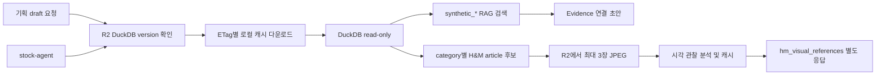

# R2 클라우드 기획 RAG 및 H&M 이미지 참고

## 현재 연결

기획 RAG가 활성화된 경우 `VOGUE_SYNTHETIC_PLANNING_RAG_SOURCE=r2`를 기본으로 사용한다. `R2_DB_KEY` 또는 선택 설정 `VOGUE_SYNTHETIC_PLANNING_R2_DB_KEY`가 가리키는 병합 DuckDB를 `HeadObject`로 확인하고, ETag/version별 로컬 캐시에 한 번 내려받아 DuckDB read-only 모드로 연다. 전체 DB는 R2에서 원격 range query 하지 않는다. 캐시 경로는 `data/local/r2_planning_db`이며 Git에서 제외된다. 현재 병합 DB는 DuckDB 파일 버전 69로 생성되었으므로 런타임은 `duckdb>=2.0,<3.0`을 사용한다.



Project_06는 병합 파일의 `synthetic_workbench_metadata`, `synthetic_taxonomy`, `synthetic_products`, `synthetic_inventory_snapshots`, `synthetic_planning_documents`, `synthetic_evidence`, `synthetic_assortment_relations`, `synthetic_planning_inputs`, `synthetic_sales_market_handoffs`만 합성 워크벤치로 읽는다. `synthetic_*` 문서 검색은 기존 lifecycle·유효기간·Evidence 검증·`product_planning` 권한 필터를 그대로 사용한다. R2 object version은 `planning_knowledge_source.index_version`과 각 retrieval run에 남는다.

R2 연결 실패 시 초안 생성은 계속하고 검색 결과는 사용하지 않으며, 응답의 `planning_knowledge_source.status=unavailable`과 retrieval 제한사항으로 상태를 돌려준다. DB 객체의 크기, 버전, 다운로드 크기 일치, synthetic marker와 요구 테이블을 검사한다. 다운로드는 임시 파일에 완료한 후 원자적으로 캐시에 반영한다.

## H&M 이미지 참고

이미지 후보는 병합 DB의 H&M `articles`와 `article_attrs`에서 요청 카테고리와 일치하는 소수의 `article_id`만 고른다. 사진은 R2의 `<R2_IMAGE_PREFIX>/<article_id 앞 3자리>/<article_id>.jpg` 규칙으로 필요할 때 가져온다. 각 이미지는 8 MB 이하 JPEG인지 확인하고 해시를 기록한다.

최대 3장의 카테고리 일치 이미지를 OpenAI Responses API에 보내 눈에 보이는 의복 종류, 색, 실루엣, 레이어링, 디테일만 관찰한다. 사진에는 `VOGUE_HM_KAGGLE_IMAGE_ALLOW_PROVIDER_UPLOAD`와 일반 `VOGUE_R2_IMAGE_ALLOW_PROVIDER_UPLOAD` 설정이 모두 허용일 때만 provider 전송을 시도한다. 시각 분석도 `VOGUE_HM_IMAGE_ANALYSIS_ENABLED`로 제어한다. 결과는 이미지 해시·모델·prompt version별 로컬 캐시에 보관한다. API 응답에는 authenticated `/api/hm-reference-images/<article_id>.jpg` preview route를 함께 돌려 프런트엔드에서 참고 사진을 확인할 수 있게 한다.

현재 로컬 `.env`의 provider 허용 설정은 사용자 요청에 따라 켜져 있고, 실제 통합 검증에서 4장의 H&M 사진이 vision provider에 전송되어 관찰 결과를 받았다. Kaggle의 공식 competition rules는 데이터 이용을 비상업적 목적·학술 연구로 제한하고, 규칙에 동의하지 않은 주체에게 제공·전송하는 것을 제한한다. 따라서 이 토글은 기술적 제어일 뿐 사용권 승인이 아니다. 실제 상업 운영이나 범위가 불분명한 provider 전송 전에는 조직의 데이터 이용 조건을 확인해야 한다. [Kaggle competition rules](https://www.kaggle.com/c/h-and-m-personalized-fashion-recommendations/rules)

분석은 `hm_visual_references` 응답 필드에 `data_nature=external_reference`, H&M article ID, locator, image hash, 모델, visual observations 및 제한사항과 함께 별도 반환한다. 합성 회사 Evidence로 바꾸거나 회사 정책·원단 조성·가격·수요·고객 선호·판매 사실을 추론하지 않는다. H&M 사진은 신제품 단독 이미지 생성 prompt/reference에 자동으로 섞지 않는다.

카테고리별 선택은 H&M article taxonomy의 해당 분류를 사용한다. 원본 데이터에 시즌 정보가 없는 경우 요청 시즌 일치를 보장하지 않는다. 이미지가 없거나 provider 분석에 실패해도 텍스트 기획과 RAG 초안은 유지된다.

## 설정

`.env.example`을 기준으로 secret 값을 별도 관리한다.

```dotenv
VOGUE_SYNTHETIC_PLANNING_RAG_ENABLED=true
VOGUE_SYNTHETIC_PLANNING_RAG_SOURCE=r2
R2_DB_KEY=stock-synthetic-workbench-20261111-7ec096205749.duckdb
VOGUE_HM_KAGGLE_IMAGE_ALLOW_PROVIDER_UPLOAD=true
VOGUE_HM_IMAGE_ANALYSIS_ENABLED=true
VOGUE_HM_IMAGE_ANALYSIS_MODEL=gpt-6-astra
VOGUE_HM_IMAGE_REFERENCE_LIMIT=3
```

`VOGUE_SYNTHETIC_PLANNING_RAG_SOURCE=local`은 개발·fixture 비교용 fallback이다. R2 인증은 읽기 요청만 수행한다. 쓰기 권한은 DB 게시에만 쓰며 runtime에 필요하지 않다. `R2_DB_KEY` 새 객체를 Project_06 및 stock-agent가 함께 쓰도록 로컬 설정을 변경했다. 배포 secret/config를 쓰는 실행 환경에는 별도 반영이 필요하다.

### 새 환경 필수 설정 및 최소 권한

비밀 값은 실행 환경의 secret store에 설정하며 저장소에 기록하지 않는다.

| 변수 | 용도 | 필수 여부 |
| --- | --- | --- |
| `R2_ACCOUNT_ID` | Cloudflare 계정 ID, 기본 R2 endpoint 구성 | 필수 |
| `R2_BUCKET` | 병합 DB와 이미지 객체가 있는 버킷 | 필수 |
| `R2_DB_KEY` | 아래의 병합 DB object key | 필수 (또는 planning 전용 override) |
| `R2_ACCESS_KEY_ID`, `R2_SECRET_ACCESS_KEY` | R2 S3 호환 인증 | 필수 |
| `R2_ENDPOINT` | 별도 HTTPS endpoint 사용 시 | 선택 |
| `R2_IMAGE_PREFIX` | H&M 이미지 prefix (`<prefix>/<앞 3자리>/<article_id>.jpg`) | 이미지 조회 시 필수 |
| `VOGUE_SYNTHETIC_PLANNING_RAG_ENABLED=true` | 기본 초안 요청에서 RAG 사용 | 사용 시 필수 |
| `VOGUE_SYNTHETIC_PLANNING_RAG_SOURCE=r2` | 병합 DB 사용 선택 | 필수 |
| `LLM_API_KEY` 또는 `OPENAI_API_KEY` | 이미지 시각 분석 provider 인증 | 분석 시 필수 |
| `VOGUE_HM_IMAGE_ANALYSIS_ENABLED=true` | H&M 이미지 분석 활성화 | 선택 |
| `VOGUE_HM_KAGGLE_IMAGE_ALLOW_PROVIDER_UPLOAD=true` 및 `VOGUE_R2_IMAGE_ALLOW_PROVIDER_UPLOAD=true` | 해당 사진의 외부 분석 전송 허용 | provider 분석 시 필수 |

Project_06 runtime token은 해당 버킷에 한정한 **Object Read Only** 권한을 사용한다. 정확한 object key 조회에는 객체 읽기 및 metadata 확인(HEAD) 권한이 필요하다. `PutObject`, `DeleteObject`, 버킷 쓰기 권한은 runtime에 필요하지 않으며, 가능하면 객체 목록 권한도 주지 않는다. DB 게시용 쓰기 키와 서비스 runtime 읽기 키를 분리한다. stock-agent와 Project_06은 같은 `R2_DB_KEY` 값을 가리켜야 한다.

### 새 환경/캐시 초기화 확인

현재 병합 DB object key는 `stock-synthetic-workbench-20261111-7ec096205749.duckdb`이며, 실제 다운로드 크기는 812,134,400 bytes (약 774.7 MiB)였다. 첫 요청 때 DB 전체를 다운로드하므로 약 0.8 GB 이상의 여유 공간, R2 네트워크 접근, `boto3`와 DuckDB 2.x가 필요하다. 최대 3장 이미지는 각각 8 MB 제한이며 필요할 때만 따로 다운로드한다. 기본 캐시는 `data/local/r2_planning_db`, 이미지 캐시는 `data/local/r2_product_images`, 분석 캐시는 `data/local/hm_visual_analysis`이다.

기존 사용자 캐시를 삭제하지 않고 빈 임시 경로로 cold start를 재현하려면 다음처럼 실행한다. `.env` 또는 secret store에는 위의 R2 설정을 먼저 둔다.

```bash
export VOGUE_SYNTHETIC_PLANNING_RAG_ENABLED=true
export VOGUE_SYNTHETIC_PLANNING_RAG_SOURCE=r2
export VOGUE_R2_PLANNING_DB_CACHE_DIR="$(mktemp -d)/planning-db"
export VOGUE_R2_IMAGE_CACHE_DIR="$(mktemp -d)/hm-images"
PYTHONPATH=src .venv/bin/python - <<'PY'
from vogue_npp.settings import load_settings
load_settings()
from vogue_npp.sources.r2_synthetic_workbench import R2PlanningDBSettings, R2PlanningDBStore
store = R2PlanningDBStore(R2PlanningDBSettings.from_env())
dataset, version, _ = store.load_dataset()
print({"source": "r2", "version_present": bool(version), "dataset_id": dataset["dataset_id"],
       "products": len(dataset["products"]), "documents": len(dataset["documents"]),
       "evidence": len(dataset["evidence"])})
print({"tops_image_candidates": len(store.find_hm_catalog_candidates("tops", limit=3))})
PY
```

R2 DB 연결에 실패하면 텍스트 초안은 계속 생성되며 응답에서 `planning_knowledge_source.status=unavailable`과 제한사항을 확인한다. 이미지 조회·분석 실패는 `hm_visual_references` 상태와 오류 코드에 표시되고 RAG 초안은 유지된다. API 키나 이미지를 로그로 출력하지 않는다. 캐시를 완전히 지우는 대신 매번 새 임시 경로를 지정하면 서비스 캐시에 영향을 주지 않고 재다운로드 동작을 검증할 수 있다.

## 적용 확인

- 병합본의 합성 레코드는 로컬 fixture와 같은 개수로 읽힌다: products 72, documents 294, Evidence 1,109, inventory 73, assortment relations 13.
- R2 live retrieval `27SS / outerwear / sage` 결과는 `SYN-EV-ATTR-001-COLOR` 하나이며 cloud index version을 기록한다.
- 초안 API live smoke에서 R2 retrieval 상태 `ready`, `planning_knowledge.synthetic=true`, H&M 시각 참고 3건, planning board 생성 상태를 확인했다.
- 실제 선택 H&M 사진 1장은 R2에서 가져와 analyzer를 호출했고, 이후 초안 smoke에서 cache 재사용을 확인했다.
- stock-agent local `/health`는 HTTP 200, provider `cloudflare-r2`, 필수 테이블 누락 없음, image source `cloudflare-r2`를 반환했다.
- Project_06 단위 테스트는 R2 캐시·read-only 검색·합성 표식 검증·카테고리 이미지 선택·provider 차단·비용 방지용 분석 캐시와 오류 fallback을 검증한다.
- 2026-11-11 cold-start 확인: 빈 임시 캐시에서 812,134,400-byte 병합 DB를 R2에서 다시 다운로드하고 DuckDB 2.0.0으로 읽었다. 합성 products 72, documents 294, Evidence 1,109, inventory 73, assortment relations 13건을 검증했다.
- 같은 cold-start 경로로 `outerwear` 초안 함수를 실행해 RAG source `r2`, status `ready`, retrieval 6개 purpose 결과를 확인했다. `tops` 카테고리 후보 3개와 R2 JPEG 3장을 임시 이미지 캐시에 로드했다. 이 검증에서는 추가 provider 전송을 피하려고 비전 분석 플래그를 껐다. 별도 이미지 분석 live 검증은 위에서 기록한 4장 결과를 참고한다.

기존 `stock.duckdb` object는 수정하지 않았다. 롤백 시 stock-agent와 Project_06 설정에서 `R2_DB_KEY=stock.duckdb`로 되돌리면 된다. 기존 객체 존재 여부와 크기를 확인했고, 병합본은 별도 versioned key로 유지된다.

## 알려진 범위

- DuckDB는 R2 객체 전체를 버전 단위로 다운로드한 다음 read-only로 쓴다. 이 설정은 수백 MB 캐시 공간과 첫 호출의 DB 다운로드 시간이 필요하다.
- H&M 사진 시각 분석은 비전 모델이 만든 관찰이며 업무 승인·상품 사실을 대체하지 않는다. H&M 데이터 라이선스상 조직의 이용 조건은 별도로 확인해야 한다.
- 현재 R2 DB를 쓰는 Project_06 경로는 로컬 API와 설정에서 확인했다. 운영 호스팅의 secret/config 변경과 배포는 이 workspace에서 수행하지 않았다.
