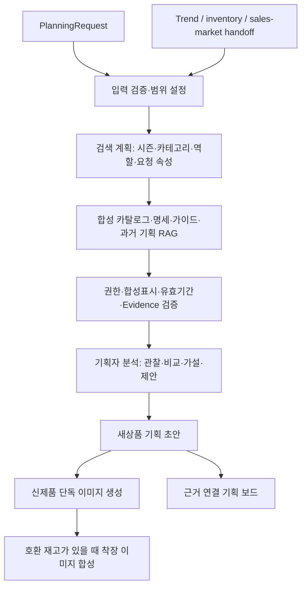

# 합성 사내 카탈로그·가이드 RAG 기반 신상품 기획 작업 계획

- 상태: 합성 RAG 기준선 구현 완료 · 실제 회사 자료원 미연결
- 대상: Project_06 새상품 기획 에이전트
- 전제: 실제 회사 내부 카탈로그·가이드·과거 상품 데이터는 접근할 수 없음
- 현재 합성 기준선: [합성 상품기획 workbench](synthetic-planning-workbench.md)
- 관련 설계: [기획 RAG](planning-rag-design.md), [RAG 고도화 계획](planning-rag-evolution-plan.md), [데이터 출처·Evidence 경계](data-source-and-evidence-plan.md)

## 1. 목적과 결정

Project_06은 외부 에이전트 결과만으로 상품 속성과 이미지를 결정하지 않는다. 외부 입력은 사용자의 의도, 트렌드 후보, 재고 맥락, 판매·시장 분석을 전달하는 **참고 신호**로 유지한다. 상품의 실제 기획 기준과 비교 맥락은 합성 사내 카탈로그, 합성 상품 명세, 합성 브랜드·카테고리 가이드, 합성 과거 기획 사례를 검색해 구성한다.

RAG 검색 결과를 분석 맥락으로 삼아 기획자가 검토할 새 상품 제안을 만든다. 각 제안은 검색된 합성 기준과 외부 참고 입력, 창작 제안, 미확정 사항을 구분하고 출처와 Evidence를 보존한다. 합성 데이터는 회사의 실제 정책·상품·성과가 아니며, 합성 RAG 실험 결과도 실제 현업 성능을 입증하지 않는다.

현재 저장소에는 합성 카탈로그/가이드 데이터셋, 로컬 탐색 CLI, 합성 corpus 검색 adapter가 이미 있다. 그러나 합성 workbench dataset은 기본 초안/API 검색 경로와 연결되어 있지 않고, 실제 vector/graph 인덱스도 없다. 본 계획은 새 데이터를 무작정 추가하기보다 현행 합성 dataset을 확장·검증하고, 허용된 합성 검색을 기획 흐름에 명시적으로 연결하는 순서를 제안한다.

## 2. 데이터 사용 범위와 H&M 사진 처리

사용 가능한 유일한 외부 실물 자료는 Kaggle의 H&M Personalized Fashion Recommendations 상품 사진이다. Kaggle competition rules는 Competition Data를 비상업적 목적과 학술 연구에 한정하며, 외부에 재배포하거나 참가 규칙에 동의하지 않은 사람에게 접근을 제공하지 못하도록 한다. 따라서 H&M 사진을 회사 카탈로그로 취급하거나, 합성 사내 상품의 실제 이미지처럼 표시하거나, 제품 이미지 생성의 무조건적인 참조 이미지·RAG 문맥으로 전송하지 않는다. 본 계획의 기본 데이터 작업은 H&M 사진을 사용하지 않는다. 별도 실험에 활용하기 전 데이터 접근자/조직의 이용 조건을 확인하고, 허용 범위·보관 위치·모델 전송·결과물 공유 여부를 기록한다. [Kaggle competition rules](https://www.kaggle.com/c/h-and-m-personalized-fashion-recommendations/rules), [Kaggle dataset page](https://www.kaggle.com/competitions/h-and-m-personalized-fashion-recommendations/data?select=transactions_train.csv)

초기 합성 데이터는 실제 사진 없이 텍스트와 구조 데이터로 구성한다. 이미지 기능 검증이 꼭 필요할 때만 승인된 로컬 환경에서 H&M 사진을 **비검색·비생성 평가용**으로 제한해 다루는 방안을 별도 승인 대상으로 기록한다. 사진으로부터 속성 태그·캡션을 생성하거나 임베딩을 만들어 저장하는 것도 데이터 이용 범위와 파생물 취급에 포함해 사전 검토한다. Kaggle 접근 권한 자체가 상업적 서비스, API 전송, 파생 데이터 배포 권한을 의미한다고 가정하지 않는다.

## 3. 목표 데이터셋

현재 `data/fixtures/synthetic_planning_workbench/dataset.json`을 기준으로 아래 레코드와 관계를 보강한다. 기존 `scripts/generate_synthetic_planning_workbench.py`를 확장해 seed와 generator version으로 재현 가능하게 만든다.

| 데이터 유형 | 합성 레코드 예시 | 검색·분석에서의 역할 |
|---|---|---|
| 가상 카탈로그 | 가상 브랜드/라인, style, 시즌, 카테고리, 상품 역할, SKU, 판매 상태 | 유사·보완 상품 비교, 포트폴리오 공백 가설 |
| 제품 명세 | 소재 혼용률 예시, 핏, 실루엣, 기능, 마감, 색상, 사이즈 범위 | 카테고리별 속성 검토 및 기획안 구조화 |
| 사내 가이드 | 브랜드 코드, 디자인 원칙, 금지/주의 조합, 소재·품질 가이드, 카테고리 기준 | 제안의 기준 충족 여부와 검토 질문 제시 |
| 과거 기획안 | 승인/반려/초안 상태를 가진 가상 기획서, 수정 사유, 적용 시즌 | precedent 비교; 승인 상태와 재사용 범위를 구분 |
| 가상 assortment 관계 | 카테고리·역할 호환, 컬러 팔레트/레이어링 관계, 중복/공백 정의 | 신상품 포트폴리오·코디 맥락 제안 |
| 가상 Evidence/출처 | 문서 ID, 섹션/locator, 인용문, 상태, 허용 용도, 기준일, content hash | 기획 문장별 추적과 검색 재현 |
| 품질·경계 사례 | 만료 지침, 충돌 지침, 근거 끊김, 권한 미확인, 비합성 혼입 | 검색 차단·제외와 실패 처리 검증 |

수량은 검색 시나리오 커버리지를 기준으로 점진적으로 늘린다. 첫 단계는 기존 12 styles/33 documents 기준선을 유지하면서 역할·관계·예외 사례를 보완한다. 대규모 corpus나 vector 인덱스는 품질 게이트를 통과한 뒤 필요성을 측정해 결정한다.

### 3.1 공통 메타데이터와 레코드 분리

모든 문서·상품·Evidence는 `dataset_id`, `is_synthetic`, `synthetic_notice`, `generator_version`, `seed`, `snapshot_date`, 안정적 ID를 가진다. 문서에는 `document_type`, `lifecycle_status`, `effective_from/to`, `season`, `category_id`, `brand_line`, `permitted_uses`, `permission_status`, `source_locator`, `content_hash`를 둔다. 상품에는 `style_id`, `sku_ids`, `season`, `category_id`, `product_role`, 구조화된 attributes와 각 attribute의 Evidence 연결을 둔다.

합성 문서 내 `approved_example` 상태는 fixture 안의 테스트 상태일 뿐 실제 회사 승인 표시가 아니다. API·기획 보드·내보내기 결과에는 `synthetic` 표시를 함께 노출한다. 합성 Evidence ID와 외부 agent Evidence ID는 서로 다른 namespace를 사용하고, ID 충돌이 있어도 병합하지 않는다.

## 4. 목표 처리 흐름



외부 에이전트 자료는 합성 내부 지식과 별도 입력 슬롯으로 유지한다. 합성 레코드가 외부 결과의 사실성을 확인해 주는 것처럼 보이게 하거나, 합성 카탈로그 값을 실제 재고로 바꿔 쓰지 않는다. 검색 실패 시 입력된 외부 결과와 근거가 유효하면 제한을 표시하고 초안을 유지하되, 합성 근거로 뒷받침된 판단이 없음을 명시한다.

### 검색 목적별 계획

| 질의 목적 | 검색 대상 | 허용되는 결과 용도 |
|---|---|---|
| taxonomy | 가상 브랜드·카테고리 용어집 | 용어 정규화 및 분류 불확실성 표시 |
| catalog_comparison | 합성 상품과 구조화 명세 | 유사·차이·중복·누락 비교; 실재 판매/재고 주장을 금지 |
| guideline | 합성 디자인·소재·품질 가이드 | 제안 점검과 확인 질문; 실제 회사 정책으로 단정 금지 |
| precedent | 합성 기획 사례 | 가상 과거 사례와 차이를 보여주는 참고 비교 |
| assortment_relation | 합성 카테고리·역할 관계 | 구성 제안 및 코디 역할 관계 설명 |

검색 단계에서는 `season`, `category_id`, `product_role`, 사용자 요청 속성, 필요 시 외부 입력의 명시 Evidence ID를 사용한다. Project_07 payload는 현재 opaque 계약을 유지하므로 내부 상세 finding을 임의 파싱해 검색어로 쓰지 않는다. 검색 query plan, 적용 필터, 검색된 문서/Evidence ID, 제외 건수·사유, 인덱스/dataset version을 실행 trace에 남긴다.

## 5. 기획 초안과 이미지 생성의 입력 원칙

초안은 최소 다음 claim type을 구분한다.

- **입력 사실:** 사용자 요청 또는 upstream agent의 명시 결과. 해당 입력 Evidence와 상태를 연결한다.
- **합성 데이터 관찰:** synthetic catalog/guide/precedent에 실제로 기록된 범위 안의 비교 관찰. 모든 표현에 “합성 데이터 기준”을 표시한다.
- **해석/가설:** 관찰과 요청의 적용 가능성에 대한 기획자 판단. 가설임을 표시하고 Evidence가 보장하지 않는 결론을 분리한다.
- **디자인 제안:** 새 상품을 위한 창의적 속성 제안. 회사의 승인 기준이나 시장 검증 사실처럼 제시하지 않는다.
- **미확정/검증 질문:** 실제 회사 기준, 실제 assortment, 실물 샘플, 원가, 수요·판매 검증이 필요한 항목.

신제품 단독 이미지 요청은 초안 중 디자인 제안과 허용된 참고 방향만 받아서 상품 시안을 생성한다. 합성 기존 상품의 사진이라고 오인될 asset이 없으므로, 첫 버전은 텍스트 기반 생성 지시를 기본으로 한다. RAG 문서 원문, Evidence ID의 시각적 텍스트 출력, 판매·시장 상세값을 이미지 provider 입력으로 자동 첨부하지 않는다. 내부 기준을 넘어서 임의로 선택한 시각 요소는 “시각화 제안”이다.

착장 이미지는 신제품 이미지 생성과 별도 단계다. 재고 agent가 실제 재고 상품 이미지와 허용된 정보까지 제공할 때만 호환 재고를 사용한다. 합성 카탈로그 상품 이미지는 실제 재고 이미지로 가장하지 않으며, 필요하면 “가상 스타일링 예시”로 분리한다. 계획 보드는 관찰·출처·합성 제한·제안·미확정 질문을 텍스트 레이아웃으로 보여준다.

## 6. 단계별 작업 계획과 완료 기준

### Phase 0 — 데이터 및 이용 경계 정리

**작업**

- H&M Kaggle 사진의 로컬 위치·취득 경로·당시 동의한 조건을 확인하고, 사용할지 여부를 데이터 카드에 명시한다.
- 기본 합성 데이터 파이프라인은 H&M 사진 없이도 동작하도록 분리한다.
- 합성 데이터 외의 실데이터, 개인정보, 비밀정보가 섞이지 않았는지 검사하는 입력 게이트를 정한다.
- Project_07 handoff의 필수 전송 계약과 Project_07 상세 opaque 경계를 명시한다.

**완료 기준**: 데이터 원천·권한·금지 용도·저장 위치·삭제 기준과 합성/실물 분리 정책이 문서화되고 리뷰된다. 미확인 권한은 허용으로 추정하지 않는다.

### Phase 1 — 합성 데이터 설계와 생성

**작업**

- 현행 workbench schema를 살펴서 상품·문서·Evidence·taxonomy 관계의 안정 ID와 속성별 Evidence 모델을 정의한다.
- 위 데이터 유형과 시나리오를 generator에 추가한다. seed, generator version, dataset hash가 재현되어야 한다.
- 정상/예외 데이터의 비율을 기록하고, 모든 합성 레코드에 synthetic marker를 보존한다.
- “가이드와 카탈로그가 서로 모순”, “유사 상품은 있지만 소재 근거 누락”, “카테고리 용어가 alias”, “문서 만료”, “접근 불허”, “검색 결과 없음” 등의 평가 케이스를 만든다.

**완료 기준**: 재생성 결과가 결정적이고 스키마 검사·참조 무결성·Evidence 연결 검사·합성 표시 검사를 통과한다. 테스트 데이터만으로 구성되며 외부 사진 권한에 의존하지 않는다.

### Phase 2 — RAG 문서화와 인덱스 기준선

**작업**

- 구조화 상품 record와 자연어 문서를 분리해 저장하고, 원본 레코드/문서 locator를 잃지 않는 검색 단위를 만든다.
- 초기에는 기존 `SyntheticCorpusRetriever`와 결정적 lexical 검색을 연결한다. Dense/vector는 비교 측정 전까지 추가하지 않는다.
- metadata filter와 allowlist를 검색기에서 강제한다. `synthetic_only` 데이터는 실제 운영 자료 검색과 섞이지 않게 dataset namespace를 분리한다.
- top-k 결과에 검색 설명·source locator·content hash·synthetic marker·evidence ID를 포함한다.

**완료 기준**: exact ID, 키워드, alias, 필터, 만료·권한 거부, no_results 시나리오의 검색 결과가 재현되고, 권한 없는 문서가 context에 유입되지 않는다.

### Phase 3 — RAG 기반 기획 분석·생성 연결

**작업**

- planning workflow가 초안 작성 전 RAG를 호출하고 결과를 `PlanningKnowledgeContext`로 전달하도록 연결한다.
- 합성 자료는 별도 타입·namespace 및 명시 설정으로만 초안 생성에 사용한다. 합성 검색을 기본 운영 자료로 암묵 연결하지 않는다.
- 초안 claim을 관찰·해석/가설·제안·미확정으로 분리하고, claim별 source/evidence refs와 synthetic notice를 출력한다.
- 검색 결과 없이도 초안을 만들되, 근거 부족과 확인 질문을 표시한다. RAG 결과 자체가 “추천 점수”나 수요 예측이 되지 않게 한다.
- 입력 payload, 검색 context, 생성 지시를 분리해 prompt injection 및 잘못된 인용 연결을 테스트한다.

**완료 기준**: 모든 합성 기반 관찰에 해당 문서·Evidence가 연결되고, Evidence에 없는 상품 사실을 검색 기반 사실로 출력하지 않는다. 검색 미실행·오류·빈 결과가 구분되고 초안 응답에 나타난다.

### Phase 4 — 이미지와 기획 보드 연결

**작업**

- 신제품 이미지에는 승인된 생성 제안만 전달하고, 검색 문서 원문·합성 기존 상품 이미지·재고 상품이 섞이지 않는지 입력 trace를 검증한다.
- 결과 이미지와 계획 보드에 합성 자료를 사용한 경우 보드에 synthetic context 표시를 넣는다.
- 착장 합성은 실제 재고 agent의 실제 이미지가 공급되는 별도 허용 경로로 유지한다. 합성 상품은 실재 재고라고 표현하지 않는다.

**완료 기준**: 제품 이미지와 착장 이미지의 입력 자산 trace가 분리되고, synthetic corpus가 provider 입력에 실수로 전달되지 않는다. 합성 근거 표시는 보드/응답에서 확인 가능하다.

### Phase 5 — 평가와 제한 공개

**작업**

- 고정된 seed/dataset snapshot의 query set으로 retrieval 및 draft 결과를 평가한다.
- RAG 지표: Recall@k, Evidence precision, source/locator 완전성, 권한 위반 건수, stale 문서 유입, Evidence 없는 claim 비율, 질문별 no_results 정확성을 측정한다.
- 기획 품질은 별도 합성 시나리오와 평가 rubric으로 MD 관점의 유용성·명확성·근거성·창의성·실행 가능성을 평가한다. 합성 평가자 점수는 현업 검증으로 부르지 않는다.
- RAG 미사용 baseline과 비교하고, 생성 모델 변경 시 동일 query, evidence snapshot, prompt version에서 재실행한다.

**완료 기준**: 고정 평가 세트와 실패 예시가 버전 관리되고, 개선/악화 근거와 알려진 한계가 보고된다. 실제 회사 효용에 대한 결론은 내리지 않는다.

## 7. 제안 데이터 계약 예시

```json
{
  "dataset_id": "SYNTHETIC-PLANNING-CATALOG-001",
  "is_synthetic": true,
  "synthetic_notice": "가상 데이터이며 실제 회사 정책·상품·성과가 아닙니다.",
  "generator_version": "1.0.0",
  "seed": 20261111,
  "snapshot_date": "2026-11-11",
  "document": {
    "document_id": "SYN-DOC-GUIDE-OUTER-001",
    "document_type": "guideline",
    "lifecycle_status": "approved_example",
    "season": "27SS",
    "category_id": "outerwear",
    "permission_status": "synthetic_only",
    "permitted_uses": ["product_planning", "retrieval_evaluation"],
    "locator": "section:material-and-function",
    "evidence_ids": ["SYN-EV-GUIDE-OUTER-001"],
    "content_hash": "sha256:..."
  }
}
```

이 구조는 제안이며 Project_06 내부 fixture 계약으로 시작한다. 외부 agent 계약이나 회사 데이터 스키마라고 간주하지 않는다.

## 8. 운영·보안·데이터 격리 요구

- `synthetic_only`, 실제 회사 자료, 외부 Kaggle 출처를 저장소·인덱스·설정 allowlist에서 구분한다.
- 검색 결과마다 `permission_status`, `permitted_uses`, `is_synthetic`을 재검사하며 누락은 deny-by-default로 처리한다.
- 합성 fixture를 운영 모드에서 사용하면 명시 경고·설정·응답 provenance를 요구한다.
- prompt 입력은 retrieved content를 신뢰되지 않은 자료로 취급한다. 문서 본문 지시를 시스템/개발 지시로 승격하지 않는다.
- 원문 본문 대신 최소 필요한 quote/locator를 보존하고, 모든 검색·인용 결과에 dataset/index version을 기록한다.
- H&M 이미지·파생 캡션·임베딩은 별도 격리한다. 조건 검토가 완료되기 전 합성 corpus, 기획 보드, 이미지 provider 요청에 섞지 않는다.
- 검색·초안 결과의 synthetic marker는 직렬화, 로그/trace, 계획 보드까지 유지한다.

## 9. 범위 밖과 의존 사항

- 내부 회사 카탈로그/가이드에 대한 실제 접근이나 그 자료가 있다고 가장하기
- Project_07 판매·시장 세부 payload를 opaque 계약 바깥에서 해석하기
- H&M Kaggle 데이터의 상업적 사용, 공개 배포, 이미지 생성 모델 전송 권한을 추정하기
- 실물 사진에서 회사 브랜드 정체성·성능·소재를 자동 추정해 사내 사실처럼 등록하기
- 실제 매출·수요·상품 성공 예측이나 자동 제품 채택
- Vector DB, graph DB, production connector를 초기 합성 검증 전에 선결정하기

## 10. 구현 권고 순서

1. 현행 synthetic workbench schema와 검색 포트에 데이터 카드·ID·Evidence 메타데이터 차이를 정리한다.
2. generator와 quality checks를 확장해 카탈로그·가이드·precedent 사례를 생성한다.
3. 고정 검색 평가 set을 만든 후 deterministic retriever에서 예상 결과를 검증한다.
4. RAG context를 draft workflow에 선택적 합성 모드로 연결하고 Evidence 추적을 결과 모델에 추가한다.
5. prompt와 초안 문장에 합성 관찰·가설·제안을 구별해 반영한다.
6. 이미지/보드 입력 경계를 확인하고 synthetic notice를 표시한다.
7. baseline과 평가 리포트를 기준으로 dense retrieval, KG 확장, 실제 자료 연결의 다음 우선순위를 결정한다.

기존 합성 workbench가 이미 있으므로 1~3단계에서 중복 데이터 모델이나 별도 RAG demo를 새로 만들지 말고, 해당 기준선을 기획 workflow에 안전하게 연결하는 것을 첫 구현 목표로 둔다.

## 11. 구현 기록 (2026-11-11)

- **Phase 0–1 완료:** Kaggle H&M 사진은 기본 generator·검색 corpus·상품 이미지 생성 입력에서 분리했다. 데이터 카드에 출처 및 제한을 기록하고, 합성 fixture를 schema v2로 확장했다. 고정 seed `20261110`에서 상품 12개, 문서 36개, Evidence 96개, assortment 관계 1개를 생성하며, 속성별 Evidence·공통 합성 provenance·locator·content hash를 유지한다. 의도적으로 넣은 품질 anomaly 2건(중복 SKU와 orphan Evidence)은 quality checker가 계속 표시한다. Kaggle 이용 조건에 대한 조직 차원의 허가 확인은 이 구현에서 수행하지 않았다.
- **Phase 2 완료:** 별도 synthetic dataset namespace의 deterministic lexical retriever를 추가했다. catalog comparison, planning reference, precedent, taxonomy, assortment relation, exact Evidence lookup을 목적별로 분리하고, allowlist·역할·카테고리·시즌·lifecycle·유효기간·권한·Evidence 조건을 적용한다. vector/graph index나 외부 자료원은 연결하지 않았다.
- **Phase 3 완료:** `VOGUE_SYNTHETIC_PLANNING_RAG_ENABLED` 기본값은 `false`다. 명시적으로 켠 경우에만 workbench를 초안 전 검색에 사용한다. 검색 상태·query trace·snapshot·Evidence 연결을 응답에 보존하고, synthetic observation·design proposal·미확정 질문을 다른 필드로 출력한다. Project_07은 opaque 경계에 그대로 남는다.
- **Phase 4 완료:** 검색 문서 본문과 합성 사진은 신제품 이미지 provider 입력에서 제외한다. planning board는 synthetic context를 표시하고 출처 Evidence를 연결한다. 재고 코디 이미지 단계에서는 Kaggle H&M article ID 사진도 R2에서 가져와 image provider로 전송한다. 이 허용은 generic R2 upload 설정과 독립적으로 적용되며 신제품 단독 이미지에는 재고 이미지를 보내지 않는다. `VOGUE_R2_IMAGE_ALLOW_PROVIDER_UPLOAD=true` 기본값은 다른 R2 재고 이미지 흐름에 유지된다.
- **Phase 5 완료:** 고정 평가 세트 8개 질의, no-RAG baseline, deterministic retriever 지표를 추가했다. snapshot `6e9bb74f…`에서 RAG baseline은 Recall@10 1.00, 평균 Precision@10 0.83, source/locator/hash 완전성 1.00, 권한 위반 0건, stale 유입 0건, no-result 정확도 1.00을 기록했다. no-RAG Recall@10은 0.00이다. 이 평가는 합성 fixture 회귀 결과일 뿐 실제 현업 효용을 입증하지 않는다. MD 품질의 사람 점수는 아직 기록하지 않았으며 평가 rubric만 제공한다.

재현 명령: `PYTHONPATH=src python3 scripts/evaluate_synthetic_planning_rag.py --output docs/evaluation/synthetic-planning-rag-baseline.json`. 기준 질의 세트는 `data/fixtures/planning_rag/synthetic_workbench_eval_queries.json`, 검토 rubric은 `docs/evaluation/synthetic-planning-rag-rubric.md`에 둔다. 다음 확장 전에는 합성 평가의 품질 기준을 검토하고, 실제 회사 자료·H&M 사진의 새 사용은 별도 권한 및 데이터 계약 검토 대상으로 유지한다.
