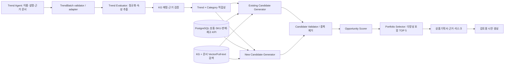

# GraphRAG TrendBatch 기반 VOGUE 상품기획 에이전트 설계

- 상태: **부분 기준선 구현** · 운영 adapter/공통 wire API 및 데이터 연결 미완료
- 기준일: 2026-11-06
- 적용 저장소: `KG/00_project/project_06` (현재 New Product Planning Agent 프로토타입)
- 목표: 트렌드 담당자가 순위·유사도 없이 전달하는 이름·설명·근거 문서로부터, 자사 상품·판매·재고 근거를 결합해 검토 가능한 상품기획 TOP 5와 시각 시안을 만든다.
- 읽는 법: **[현재 구현]**은 저장소 코드·자료에서 확인한 내용, **[제안]**은 아직 구현되지 않은 목표 설계다. “확정”은 이 대화에서 제품 요구사항으로 정한 범위만 뜻하며 기술 스택/공통 API 합의를 뜻하지 않는다.
- 2026-11-06 구현 메모: 계약 검증, 규칙 기반 evaluator, adapter ports, 후보/scorer/selector 및 내부 use case는 아래의 “구현 기준선”에 설명한다. `tests/` 회귀 검증을 실행했다. H&M Kaggle 원자료는 변경하지 않았다.

## 1. 요약과 결정 경계

### 제품 요구사항으로 확정된 방향

1. Trend Agent가 주는 값은 trend name, description, evidence documents다. 검색 순위와 similarity score는 없으며 필수 입력으로 요구하지 않는다.
2. Trend Evaluator는 트렌드의 전역 인기 순위를 흉내 내지 않는다. 정규화·속성 추출·KG 매핑·근거 검증을 한 뒤 `Trend × Category` 적용 적합성을 평가한다.
3. Existing Candidate와 New Candidate를 함께 만들고, KG/RAG 근거 및 SQL의 상품·판매·재고 분석으로 기회를 검토한다.
4. Opportunity Scorer가 근거·적합성·사업 기회·재고 리스크를 평가하고, 중복 억제와 포트폴리오 다양성을 고려해 최대 TOP 5를 선택한다.
5. 결과는 근거와 불확실성을 포함한 상품기획서 및 검토용 시안이다. 승인·발주·생산 가능성 확정이 아니다.
6. 실제 운영 구현 전제는 상품, 판매, 재고 데이터를 확보하는 것이다. 현재 저장소에 있는 H&M Kaggle 과거 자료나 합성 fixture가 실제 회사 운영 데이터라고 간주하지 않는다.

### 아직 확정되지 않은 기술 선택

PostgreSQL/Neo4j/pgvector 또는 별도 Vector DB, API framework, Pydantic 버전, 모델 제공자, 인증·배포, 공통 wire schema는 기존 합의로 확인되지 않는다. 아래에 구체 실행안을 제안하되 기술 결정으로 간주하지 않는다. SQL은 정량 원장의 기준 저장소로 권장하고, 그래프·문서 검색 구현은 어댑터 경계에 둔다.

## 2. project_06 실제 현황

### 저장소 구조에서 확인한 점

| 위치 | 확인된 내용 | 상태 |
|---|---|---|
| `src/vogue_npp/domain/context.py` | `PlanningRequest`, `TrendResult`, `SalesAnalysisResult`, `InventoryProductResult`, `ProductPlanningContext` 내부 dataclass. request ID·schema version·상태·Evidence ID 및 제한 보존 | 구현 |
| `src/vogue_npp/domain/analysis.py` | Evidence가 있는 트렌드 속성과 자사 상품 속성의 보수적 비교. 카탈로그 미완전성을 상품 부재로 단정하지 않음 | 구현 |
| `src/vogue_npp/domain/generator.py`, `concept.py` | 결정적 규칙 기반 `ProductConceptDraft` 및 입력 Evidence ID allowlist 검사 | 구현 |
| `src/vogue_npp/sources/hm/` | H&M Kaggle 원천 파일의 로컬 처리, 과거 상품·거래 집계 및 adapter | 구현. 사내 SQL/API 아님 |
| `src/vogue_npp/prototype/` | Python 표준 라이브러리 로컬 HTTP prototype, 합성 demo 자료 검색/SQLite 기록, H&M 결과 별도 조회 | 구현. 운영 API/KG 아님 |
| `src/vogue_npp/workflows/planning.py` | 선택한 H&M 과거 판매 기회에서 Evidence·가설·미확정을 분리한 기획 브리프 초안 생성 | 구현 |
| `src/vogue_npp/workflows/image_generation.py` | 근거/제안 구분 이미지 프롬프트 및 설정·요청별 확인을 거친 이미지 provider 연계 | 구현. 전체 TOP5 자동 시안 pipeline 아님 |
| `src/vogue_npp/domain/trend_batch.py` | dependency-free `TrendBatch.from_json/from_mapping`; size/length/count/duplicate ID, evidence trace field, HTTP(S) reference format validation. `rank`/`similarity` 같은 unknown fields reject | 구현. Pydantic 미도입 |
| `src/vogue_npp/domain/trend_evaluator.py` | name normalization, excerpt-backed dictionary attributes, category exact/alias/ambiguous/unmapped adapter, EvidenceResolver port, Trend × Category evaluation with explicit versioned weights | 구현 기준선. taxonomy/resolver/fit weights 미제공이면 abstain; ML/LLM 및 KG mapping 없음 |
| `src/vogue_npp/domain/retrieval.py` | KnowledgeRetriever, ProductCatalogRepository, MerchDataRepository ports 및 no-index/unconfigured/in-memory adapters; SQL 기간·채널·상품·재고 기준시점 filter contracts | 구현 기준선. 운영 DB/graph/vector connector 없음 |
| `src/vogue_npp/domain/candidates.py` | Existing/New 후보 공통 모델, evidence/metric/KG refs, 설정형 scorer, dedup/category-cap portfolio selector | 구현 기준선. 승인된 business weights/metric normalizer 없음 |
| `src/vogue_npp/workflows/trend_planning.py` | API-neutral planning use case, deterministic run ID, candidate brief DTO, opt-in image adapter | 구현 기준선. 공용 HTTP API/저장/async job 없음 |
| `tests/` | 위 신규 domain/use-case 동작과 기존 context, planning, H&M adapter, image flow 회귀 테스트 | 본 구현에서 전체 테스트 실행; 아래 구현 보고의 결과 참조 |
| `requirements.txt`, `compose.yaml` | `python-dotenv` 중심 의존성, prototype 한 서비스; Pydantic/FastAPI/SQL/Neo4j/vector service 의존성 없음 | 현재 파일 기준 |
| `data/processed/hm-personalized-fashion-recommendations/` | H&M에서 유래한 가공 CSV/JSON | 실제 파일 존재. 데이터 이용 조건과 README 제한을 따름 |

### 요청하신 목표 흐름 대비 공백

| 기능 | 현재 상태 | 목표 제안 |
|---|---|---|
| 외부 TrendBatch 입력 | `TrendBatch` 내부 JSON validator 구현. transport endpoint와 Pydantic은 없음 | 공통 wire contract 결정 및 API adapter |
| 이름·설명·근거 중심 Trend Evaluator | 규칙 기반 추출 및 `Trend × Category` evaluator 구현. 속성 사전은 제한적이며 Evidence excerpt 매치 기준 | 승인된 taxonomy, extractor 개선 및 golden-set 평가 |
| 근거 문서 검증 | `EvidenceResolver` port와 metadata-only resolver 구현. 기본 resolver는 URL을 조회하지 않고 `unverified` 반환 | 승인 원문 저장소/권한/인용 검증 adapter |
| KG | graph DB/client/schema/query 없음 | 상품 taxonomy·속성·트렌드·문서 관계 KG |
| RAG | prototype의 키워드 fixture 검색 및 Evidence 조회 있음 | 승인 문서 hybrid retrieval과 KG traversal |
| SQL 상품/판매/재고 원장 | 없음. H&M 파일 분석과 demo SQLite 존재 | 운영 데이터 PostgreSQL 권장, SQL 집계 API |
| Existing + New 후보 통합 | 공통 Candidate와 두 생성기 구현. 신규 후보는 scored Trend × Category 및 verified evidence 필요 | 운영 KG/catalog/SQL adapter 및 attribute mapping |
| Opportunity Scorer/TOP5 다양성 | configurable score, coverage gate, deterministic max-per-category selector 구현 | 승인된 normalization/weights/threshold 및 MD 효용 평가 |
| 기획서/시안 | CandidateBrief DTO 및 기존 opt-in 이미지 provider 재사용 함수 구현 | 저장/전달 UI와 선정 후보 전체 이미지 작업 연결 |

> 현재 저장소 설명은 VOGUE 3번 New Product Planning Agent 범위를 좁게 두고 4번 Feasibility 및 5번 MD Review를 다른 책임으로 분리한다. 본 설계의 사업성 점수는 제공된 판매·재고와 합의된 범위의 기회 평가다. 원가·마진·제조 가능성의 확정 판정, MD 승인 이력/최종 승인 workflow는 포함하지 않는다.

## 3. 목표 처리 아키텍처



한 TrendBatch를 여러 평가 결과로 분해하고, 평가 결과별로 카테고리를 탐색한다. 각 점수는 명시된 입력 자료 안에서 상품 후보의 상대적 우선순위를 정하는 내부 신호다. GraphRAG의 순위나 유사도를 재구성한 값 또는 시장 트렌드 강도라고 부르지 않는다.

## 4. Trend Agent 입력 계약과 내부 검증 모델

### 최소 계약

순위·유사도 필드는 일부러 두지 않는다. 담당자가 넘길 수 있는 정보만 필수로 한다. `trend_id`, season, target category는 배치 통합에 유용하지만 source가 제공하지 않을 수 있으므로 nullable/adapter 생성값으로 둔다. `evidence`는 추적 가능한 문서 ID와 인용 구절 또는 조회 가능한 locator를 요구한다.

```json
{
  "schema_version": "1.0",
  "batch_id": "TB-2027FW-001",
  "received_at": "2026-11-06T09:00:00Z",
  "target_season": "2027FW",
  "trends": [
    {
      "trend_id": "T-001",
      "name": "Burgundy",
      "description": "버건디 컬러를 활용한 가을·겨울 패션 트렌드",
      "evidence": [
        {
          "document_id": "DOC-001",
          "title": "예시 리포트",
          "source_url": null,
          "published_at": "2026-10-20",
          "excerpt": "원문에서 해당 해석을 뒷받침하는 인용 구간",
          "locator": "p.12"
        }
      ]
    }
  ]
}
```

예시 값은 계약 설명용 가상 데이터다. 원문 전문은 별도 승인 문서 저장소에서 ID로 해석하는 방식을 권장한다. excerpt만 들어오면 원문과 일치 여부를 검증할 수 없으므로 검증 수준을 `citation_unverified`로 표시한다.

### 구현 사항 및 Pydantic 선택

현재 코드는 표준 라이브러리 dataclass + 명시적 validator로 구현되어 있고 `requirements.txt`에 Pydantic을 추가하지 않았다. 로컬 및 `.venv` 환경에 Pydantic이 없었으며, 현재 저장소는 Python 표준 라이브러리 도메인 코어를 사용하고 HTTP framework도 선택되지 않았다. 따라서 외부 의존성을 추가하지 않았다. 아래 Pydantic v2 코드는 기존의 **선택 가능한 API-layer 제안**이며 현재 구현과 혼동하지 않는다.

```python
from datetime import date, datetime
from typing import Annotated
from pydantic import BaseModel, ConfigDict, Field, HttpUrl, StringConstraints

NonEmpty = Annotated[str, StringConstraints(strip_whitespace=True, min_length=1)]

class EvidenceDocument(BaseModel):
    model_config = ConfigDict(extra="forbid")
    document_id: NonEmpty
    title: NonEmpty
    source_url: HttpUrl | None = None
    published_at: date | None = None
    excerpt: Annotated[str, StringConstraints(max_length=4000)] | None = None
    locator: str | None = None

class TrendInput(BaseModel):
    model_config = ConfigDict(extra="forbid")
    trend_id: str | None = None
    name: NonEmpty
    description: Annotated[str, StringConstraints(min_length=1, max_length=12000)]
    evidence: Annotated[list[EvidenceDocument], Field(min_length=1)]

class TrendBatch(BaseModel):
    model_config = ConfigDict(extra="forbid")
    schema_version: NonEmpty
    batch_id: NonEmpty
    received_at: datetime | None = None
    target_season: str | None = None
    trends: Annotated[list[TrendInput], Field(min_length=1)]
```

검증 단계에서 중복 `trend_id`와 문서 ID 충돌, 문자열/URL 길이, 허용 host, batch 최대 건수와 전체 payload 크기를 별도 검사한다. `source_url`을 서버가 무검증 fetch하면 안 되며 SSRF 방지를 위해 allowlist된 문서 커넥터만 쓴다. 날짜·사용 권한이 없다는 사실은 자동 기각이 아니라 상태/제한으로 표시하고, 정책상 요구되는 최소 provenance가 부족하면 scoring 전 보류한다.

### 정규화된 내부 결과

`EvaluatedTrend`는 원 입력을 덮어쓰지 않고 버전이 붙은 derived record로 저장한다.

- IDs: `batch_id`, `trend_id`, `evaluation_id`
- normalized: canonical name, aliases, language, deduplicated description, taxonomy/version
- extracted attributes: `attribute_type` (color/material/silhouette/pattern/style/detail/use), canonical value, confidence, supporting evidence IDs, extractor/model/prompt version
- evidence assessment: validity, relevance, recency, independence group, access status, verification method
- category fit: category ID, score 0–100, component scores, explanation, evidence IDs, blockers
- limitations/questions: missing mapping, stale/undated source, contradiction, category coverage gap
- no `source_rank`/`similarity` field; a local relevance score is explicitly named by its target (e.g. `category_fit_score`).

## 5. Trend Evaluator 상세 설계

### 단계와 규칙

1. **Validate batch:** schema/size/ID/문서 추적성 검증. 현재 내부 use case는 전체 입력/필터/config version에서 결정적 `run_id`를 만들지만 run 기록 저장이나 HTTP retry idempotency는 구현하지 않았다. 영속 job store/API adapter 단계에서 `(batch_id, input_hash, config_version)` idempotency를 구현한다.
2. **Normalize:** 공백/대소문자/언어, alias와 표준 taxonomy를 매핑한다. 자동 병합은 alias 사전 또는 관리자 확인이 있는 경우에만 한다. 원문 값과 매핑 버전 보존.
3. **Extract attributes:** LLM/룰은 이름·설명·허용된 근거 문서만 본다. 구조화된 속성마다 supporting evidence span/ID를 요구하고, 출처 없는 속성은 `hypothesis`/`to_validate`로 내려 scoring 근거에서 제외.
4. **Map KG:** canonical Attribute/Trend/Category ID를 연결한다. exact taxonomy match, synonym mapping, unresolved를 구분한다. low-confidence mapping은 대체 후보와 함께 검토 대기로 남긴다.
5. **Verify evidence:** 문서 ID 조회, 제목/locator 일치, 인용 span 존재 여부(원문이 있을 때), source permission, 발행일·수집일, 근거가 실제 해당 trend claim을 지지하는지 평가한다. 문서 개수 단순합 금지: 재인용/동일 원출처 문서를 independence group으로 묶는다.
6. **Evaluate Trend × Category:** 카테고리별 적합도를 출력한다. 카테고리 매핑 가능 여부, 디자인 속성 연관성, 시즌/시장 범위, 근거 신뢰도·최신성·독립성, 자사 상품 적용 가능성으로 구성한다. 시장 트렌드 강도·판매 순위와 구별한다.
7. **Persist audit:** 입력 hash, taxonomy version, evaluator/model version, prompt version, 문서 snapshot, 출력과 warnings를 저장해 재실행 가능하게 한다.

### 평가 score 초안 (설정값; 미합의)

`category_fit_score` (0–100)는 아래 내부 구성요소의 가중 합으로 시작할 수 있다. 가중치는 운영 전 holdout/MD 평가로 보정해야 하며 기존 시스템 확정값이 아니다.

| 구성요소 | 초기 가중치 예시 | 산출 근거 |
|---|---:|---|
| category/attribute relevance | 35% | 추출 속성·트렌드 정의가 카테고리 속성과 얼마나 구체적으로 연결되는지 |
| evidence quality | 25% | claim entailment 검토, locator 해소, 출처 신뢰 정책 |
| temporal fit | 15% | target season 대비 게시일/유효기간; 미상은 중립으로 꾸미지 않고 결측 표시 |
| independent support | 15% | 독립 출처 수/기여, 동일 원문 재인용 중복 제거 |
| product applicability | 10% | 자사 taxonomy 및 실제 설계 가능한 속성 연결 가능성; 제조 feasibility 판정은 아님 |

근거 결손이 큰 경우 weighted score를 산출하지 않고 `insufficient_evidence` 상태로 보류한다. 구성요소별 점수·근거·결측을 함께 반환하고, TrendBatch 입력순서에 따른 우선순위는 부여하지 않는다.

## 6. 저장 모델 및 KG 모델

### PostgreSQL: 정량 원장 및 실행 기록 권장안

실제 운영 전제(상품·판매·재고 확보)를 반영한 logical schema다. 실제 ERP/PIM/판매 테이블 구조가 확인되면 adapter가 기존 원장에 맞춘다. 원본 시스템을 이 프로젝트 DB로 복제해야 한다고 확정한 것은 아니다.

| 테이블 | 키/핵심 컬럼 | grain/용도 |
|---|---|---|
| `product` | `product_id`, `name`, `category_id`, `brand_id`, `lifecycle_status`, `season`, `source_system`, `valid_from/to` | Style/상품 마스터 |
| `sku` | `sku_id`, `product_id`, `color_id`, `size_id`, `attributes_json`, `active` | variant 단위 상품 |
| `category` | `category_id`, `parent_id`, `taxonomy_version`, `name` | versioned taxonomy |
| `product_attribute` | `product_id/sku_id`, `attribute_id`, `value`, `source_id`, `confidence`, `valid_from/to` | provenance가 있는 속성 |
| `sales_fact` | `date`, `sku_id`, `channel_id`, `units`, `net_revenue`, `currency`, `source_id` | SKU×일×채널 거래 집계; 주문수와 units 구분 |
| `inventory_snapshot` | `as_of`, `sku_id`, `location_id`, `on_hand`, `reserved`, `available`, `unit`, `source_id` | SKU×위치×시점 재고 snapshot |
| `product_kpi` | `product_id/sku_id`, `period`, `metric_name/value`, `formula_version`, `source_snapshot` | sell-through/velocity/coverage 등 계산값과 산식 버전 |
| `trend_batch`, `trend`, `evidence_document` | batch/version, input hash; document locator/date/access/hash | 입력 추적·감사 |
| `trend_evaluation` | evaluation ID, trend/category, component scores, status, version | 평가 결과 재현 |
| `candidate`, `candidate_evidence`, `opportunity_score`, `selection_run` | candidate ID/type, source refs, score breakdown, run config | 후보·근거·TOP5 결과 audit |

판매·재고 수치는 KG property에 대량 복제하지 않는다. 쿼리는 파라미터화하고, 권한·채널·시즌 필터가 빠지지 않게 한다. 판매 속도는 판매 가능 일수를 알 수 있을 때만 계산한다. 재고 coverage는 단위/시점/가용 재고 정의와 판매 일속도가 모두 유효할 때만 계산한다. 결측/미조회는 0이 아니다. 해당 컬럼 또는 원천이 존재하는지는 실제 운영 DB 확인 후 매핑한다.

### Knowledge Graph 노드

| Label | 식별 속성 | 주요 정보 |
|---|---|---|
| `Trend` | `trend_id`, `batch_id` | canonical name, description, season scope, evaluator version |
| `Category` | `category_id`, `taxonomy_version` | name, hierarchy |
| `Product` | `product_id`, `source_system` | name, lifecycle/status, season |
| `SKU` | `sku_id`, `source_system` | variant reference |
| `Attribute` | `attribute_id`, `type`, `canonical_value` | color/material/fit/style etc. |
| `EvidenceDocument` | `document_id`, `version/hash` | source, published_at, access status, locator metadata |
| `Candidate` | `candidate_id`, `run_id` | existing_improvement/new_product, status |
| `Brand`, `CustomerSegment` | domain ID | 사용 허가된 브랜드/segment context만 |

### KG 관계

```text
(Trend)-[:HAS_EVIDENCE {claim_id, confidence}]->(EvidenceDocument)
(Trend)-[:HAS_ATTRIBUTE {evidence_id, confidence}]->(Attribute)
(Trend)-[:FIT_FOR {evaluation_id, score, status}]->(Category)
(Product)-[:BELONGS_TO]->(Category)
(Product)-[:HAS_SKU]->(SKU)
(Product|SKU)-[:HAS_ATTRIBUTE {source_id, valid_from, valid_to}]->(Attribute)
(Product)-[:OWNED_BY]->(Brand)
(Candidate)-[:RESPONDS_TO {fit_score}]->(Trend)
(Candidate)-[:TARGETS]->(Category)
(Candidate)-[:IMPROVES]->(Product)
(Candidate)-[:SUPPORTED_BY]->(EvidenceDocument)
(Candidate)-[:RELATED_TO]->(Product|Attribute)
```

원장 숫자는 SQL에서 계산해 응답에 붙이고 KG에는 URI/ID 및 제한된 집계 요약과 계산 버전만 둔다. CustomerSegment는 근거·권한과 사용 범위가 확인된 경우만 사용한다. 이 프로젝트의 현재 책임에서 원가/조달/고객 피드백 분석은 제외한다.

## 7. KG-RAG 검색 계획

RAG는 문서 검색으로 주장 근거를 찾고, KG는 관계·카테고리·상품 연결을 확장한다. 순위·유사도가 upstream에서 없으므로 입력 trend 순서를 가중치로 쓰지 않는다.

### 검색 전략

- **Seed:** `EvaluatedTrend`의 표준화된 명칭, alias, 속성, 해당 evidence document ID.
- **KG traversal:** 연결 Category → 해당 카테고리의 Product/SKU → 속성 및 유사 기존 상품; Trend를 지지하는 EvidenceDocument. hop 수는 1–2로 제한하고 taxonomy/version 필터를 적용.
- **Document retrieval:** 승인 코퍼스에서 trend claim, 속성, category alias 및 season으로 BM25/full-text + embedding hybrid retrieval. 필요 시 reranker는 검색 관련도만 정렬하며 trend 강도로 해석하지 않는다.
- **SQL context:** 선별된 상품/SKU ID에 대해 기간, 채널, 시장, 판매 가능성·재고 상태를 강제 필터링해 aggregate 조회.
- **Evidence pack:** 각 후보별 claim→Evidence ID/quote/locator/date/source/access label, KG path, SQL query parameters/aggregate version을 기록.
- **No-results:** 독립 증거가 부족하면 해당 영역 score를 `null`로 두거나 candidate를 보류한다. zero result를 실제 부재/판매 0으로 치환하지 않는다.

### 예시 Cypher (Neo4j 가정; 아직 실행 코드 아님)

```cypher
MATCH (t:Trend {trend_id: $trend_id})-[fit:FIT_FOR]->(c:Category {category_id: $category_id})
OPTIONAL MATCH (c)<-[:BELONGS_TO]-(p:Product)-[:HAS_ATTRIBUTE]->(a:Attribute)
OPTIONAL MATCH (t)-[ta:HAS_ATTRIBUTE]->(a)
OPTIONAL MATCH (t)-[:HAS_EVIDENCE]->(d:EvidenceDocument)
WHERE coalesce(p.lifecycle_status, 'active') IN $allowed_statuses
RETURN t, c, fit.score AS category_fit,
       collect(DISTINCT {product_id:p.product_id, attribute:a.canonical_value}) AS products,
       collect(DISTINCT {document_id:d.document_id, evidence_id:ta.evidence_id}) AS evidence
LIMIT $limit
```

프로덕션에서는 optional match 조합으로 인한 row 곱을 피하려고 상품/문서 검색을 별도 쿼리로 나누고, 모든 입력은 parameterized query로 전달한다.

### 예시 SQL 판매·재고 조회 (PostgreSQL 가정)

```sql
WITH sales AS (
  SELECT s.sku_id,
         SUM(s.units) AS units_sold,
         SUM(s.net_revenue) AS net_revenue,
         COUNT(DISTINCT s.sale_date) AS observed_sale_days
  FROM sales_fact s
  JOIN sku k ON k.sku_id = s.sku_id
  WHERE k.product_id = ANY(:product_ids)
    AND s.sale_date >= :period_start AND s.sale_date < :period_end
    AND (:channel_id IS NULL OR s.channel_id = :channel_id)
  GROUP BY s.sku_id
), latest_inventory AS (
  SELECT DISTINCT ON (i.sku_id) i.sku_id, i.available, i.unit, i.as_of
  FROM inventory_snapshot i
  JOIN sku k ON k.sku_id = i.sku_id
  WHERE k.product_id = ANY(:product_ids) AND i.as_of <= :inventory_as_of
  ORDER BY i.sku_id, i.as_of DESC
)
SELECT k.product_id, k.sku_id, COALESCE(s.units_sold, 0) AS units_sold,
       s.net_revenue, s.observed_sale_days,
       i.available, i.unit, i.as_of
FROM sku k
LEFT JOIN sales s USING (sku_id)
LEFT JOIN latest_inventory i USING (sku_id)
WHERE k.product_id = ANY(:product_ids);
```

실제 운영에서는 `COALESCE(...,0)`가 “조회 성공 후 매칭 거래 없음”일 때만 맞다. 원천 상태와 쿼리 완료 여부를 함께 반환하고, 누락/오류는 0 대신 상태로 유지해야 한다. 프로모션, 반품, 가격·통화, 품절·판매 가능 일수의 정의가 확보되지 않으면 해당 KPI는 계산하지 않는다.

## 8. Candidate Generator

### 공통 Candidate 계약 (내부 제안)

- `candidate_id`, `candidate_type`: `existing_improvement | new_product`
- `target_season`, `category_id`, `product_id?`, `sku_ids[]?`
- `concept`: 제안 제목/요약/설명/속성 및 속성별 출처 타입
- `responds_to_trend_ids[]`, `category_fit_evaluation_ids[]`
- `evidence_refs[]`, `sql_metric_refs[]`, `kg_paths[]`
- `assumptions[]`, `unknowns[]`, `risks[]`, `validation_questions[]`
- generator/prompt/model/config version, created_at

### Existing Candidate Generator

1. Trend × Category score/상태를 통과한 category만 대상으로 한다.
2. 해당 카테고리 active Product/SKU와 근거가 있는 속성을 KG에서 찾고 SQL aggregate를 연결한다.
3. 기존 상품의 확인된 속성을 보존하면서 트렌드 속성과의 `match / complement / conflict / unknown`을 만든다.
4. 개선 후보 유형 예: verified attribute variation, color/print update, styling bundle; 입력 근거가 제시하지 않는 소재·핏 기능을 생성하지 않는다.
5. 판매 약세를 개선 기회로 단정하지 않는다. 비교 가능한 기간/채널/가격/품절 가용성이 있을 때만 기술 통계를 참고하며, 그렇지 않으면 “관측 자료 불충분”.
6. 재고 기반 제안은 시점·위치·가용 정의가 있는 경우에만 기존 SKU와 함께 묶을 수 있는지 표시한다. 재고량은 수요 점수가 아니다.

### New Candidate Generator

1. `Trend × Category`의 속성·근거 문서에서 새로운 상품 방향을 조합한다.
2. 카탈로그에서 같은 조합/유사 후보를 검색해 중복·유사도 근거를 저장한다.
3. Existing 상품과 달라야 한다는 이유만으로 속성 값을 임의 생성하지 않는다. 미제공 필드는 `proposal` 또는 `unknown`으로 구분한다.
4. 목표 가격, 마진, 생산 가능성, 고객 선호를 만들지 않는다. 해당 필드는 입력/후속 에이전트에서 제공하지 않으면 미정이다.

두 generator는 같은 validator와 scoring input shape를 사용한다. LLM은 structured output을 생성해도 되고, 인용 Evidence ID는 input allowlist와 대조한다. 이미지 생성은 선정된 후보에 대한 후속 human-review 단계로 둔다.

## 9. Opportunity Scorer와 TOP 5 포트폴리오 선택

### Score 제안 (초기 가중치 검증 필요)

후보 `p`에 대한 0–100 우선순위 점수의 한 가지 시작점:

`Opportunity(p) = 0.25*T + 0.25*D + 0.20*B + 0.15*I + 0.15*E`

| 항목 | 설명 | 데이터 조건 |
|---|---|---|
| `T` Trend/category fit | 평가된 Trend × 해당 후보 category 적합도 | `EvaluatedTrend`와 evidence 필요 |
| `D` Demand observation | 비교 가능한 과거 판매 속도/카테고리 기준 대비 | SQL 기간·채널·단위·품절 보정 가용 여부 기록. 미래수요 예측 아님 |
| `B` Brand/product fit | 브랜드·카테고리/상품 taxonomy에 적용 가능한 정도 | 허용된 상품/브랜드 맥락과 KG 근거 |
| `I` Inventory/risk | 기존 SKU availability/재고 노출 리스크; 신규는 데이터 부족을 중립 가산하지 않음 | 스냅샷 시각·단위·가용 정의 필수 |
| `E` Evidence confidence | 독립성·관련성·최신성·locator 검증 품질 | document assessment 근거 |

이 식은 **검증 전 제안**이며 코드의 기본값으로 적용하지 않는다. 구현된 `ScoreWeights`와 `TrendFitWeights`는 명시적으로 전달된 가중치만 사용하며, 가중치가 없으면 `unconfigured`로 abstain한다. Scorer는 component score 입력과 coverage를 기록하고, coverage `< 0.8` 또는 evidence가 없으면 `insufficient_data`다. 운영 전에는 점수 산식, component scale 및 weights를 MD 평가로 승인해야 한다. 결측 항목은 0/평균으로 조용히 대체하지 않는다.

### TOP 5 selector

1. validator 통과 및 필수 근거 최소 기준을 만족하는 후보만 eligible.
2. 동일 product, 동일 concept fingerprint, 거의 동일한 attribute/category 조합을 canonical ID + rule/embedding dedup으로 묶는다. 자동 merge에는 audit trail을 남긴다.
3. 점수와 tie-break 기준(coverage, evidence quality, deterministic candidate_id)을 적용해 정렬한다.
4. 포트폴리오 제약 예: 카테고리 분산, trend ID 분산, existing/new 조합을 목표로 하되, 최저 점수 후보를 무리하게 채워 넣지 않는다. 최소 점수/근거 threshold 아래면 5개 미만을 반환한다.
5. 제약과 가중치는 run configuration에 버전으로 기록하고, 선정/탈락 이유를 후보별 반환한다.

권장 시작은 top 5 최대치 + 카테고리 중복 상한 + existing/new 최소 다양성 목표지만 비율은 MD가 평가해야 한다. 근거가 부족한 New 후보를 수량 맞추기 위해 추가하면 안 된다.

## 10. 제안 API와 현재 use case

기존 `src/vogue_npp/prototype/server.py`는 로컬 prototype API다. 신규 기능은 `run_trend_planning()` 내부 use case이며 아래 endpoint는 운영용 **제안**이고 구현되지 않았다.

| Method/path | 동작 | 상태 |
|---|---|---|
| `POST /v1/trend-batches` | TrendBatch 수신/검증, batch ID와 validation warnings 응답 | 제안 |
| `POST /v1/trend-batches/{batch_id}/evaluate` | 정규화·문서 검증·속성 추출·category fit 실행 | 제안 |
| `GET /v1/trend-batches/{batch_id}/evaluations` | trend×category 결과/근거/결측 반환 | 제안 |
| `POST /v1/planning-runs` | season/category/filter 및 trend batch로 candidate generation/scoring 수행 | 제안 |
| `GET /v1/planning-runs/{run_id}` | 진행 상태, 실패, 단계별 산출물 조회 | 제안 |
| `GET /v1/planning-runs/{run_id}/candidates` | 전체 후보 및 score breakdown, top5 selection 반환 | 제안 |
| `GET /v1/candidates/{candidate_id}/brief` | 기획서·Evidence pack 조회 | 제안 |
| `POST /v1/candidates/{candidate_id}/visuals` | 사용자 확인을 거친 시안 작업 생성 | 제안 |

에러 표준(합의 전): `400` payload/schema, `409` idempotency/version conflict, `422` domain validation, `404` unknown ID, `202` async run accepted, `200` complete. 공통 envelope/status/error code는 상위 VOGUE API 계약과 합의해야 한다. 인증/권한/테넌트 범위는 운영 DB 연결 전에 설계해야 한다.

## 11. 테스트·평가 및 관찰성

### 자동 테스트 시나리오

- TrendBatch 필수 필드, extra field 거부, 빈 배열/긴 payload/ID 중복; deterministic run ID 재현. 영속 idempotency는 API/job store 단계 미구현.
- 문서 ID 없음, URL 미허용, 원문과 인용문 불일치, undated/stale/중복 재인용 evidence 및 permission 미확인 처리.
- KG exact mapping, alias mapping, ambiguous mapping, unknown category, taxonomy version drift.
- Trend × Category: 동일 트렌드라도 category에 따라 다른 fit; upstream rank/similarity 없이 동작.
- SQL: sales row 없음 vs query failure, inventory 0 vs missing snapshot, reserved/available 정의, 기간·채널·상품 ID 필터, stockout-day 보정 불가.
- Existing/New: 같은 Candidate schema, provenance 및 input Evidence allowlist 검증, 미지원 속성 생성 차단/label.
- Scorer: missing metrics는 null/coverage 감소, normalization 재현, weights version 저장, 낮은 근거 후보 제외.
- Selector: duplicate 억제, 카테고리/트렌드 다양성, 데이터 충분 후보가 5개 미만일 때 개수 축소.
- Proposal/visual: claim별 source, known vs hypothesis, prompt/이미지 model version; 외부 이미지 호출은 opt-in.

### 품질 평가

- **Evaluator:** MD가 category별 적용 적합성 라벨링. NDCG@k/precision@k를 평가할 때 사람 정답 판단을 마련한다. 검색 유사도 자체를 정답으로 삼지 않는다.
- **Evidence:** claim support/contradiction, citation locator validity, freshness, independent-source handling.
- **Candidates:** request compliance, factual grounding, concept specificity, novelty-within-own-catalog, duplicate rate, category/trend coverage, MD usefulness.
- **Ranking/portfolio:** blinded MD pairwise preference, top-5 acceptance/utility, diversity, evidence coverage 및 하위그룹별 점검.
- **Ops:** latency, LLM token/cost, DB query timing, retries/errors, trace ID, versioned prompts/index/snapshot.

Baseline와 변경 후는 동일한 고정 TrendBatch, 문서 snapshot, SQL snapshot, KG/taxonomy version으로 비교한다. H&M competition 결과와 synthetic fixture는 pipeline 검증에 쓸 수 있지만, VOGUE 회사 상품기획 품질의 대표 성능으로 보고하지 않는다.

## 12. 구현 순서

| 단계 | 산출물 | 완료 조건 |
|---:|---|---|
| 0. 계약/기준 데이터 정의 | 내부 TrendBatch JSON validation 구현; Pydantic/HTTP adapter, taxonomy/Evidence 정책, SQL mapping 일부 미정 | 내부 validator 회귀 테스트 통과; 공통 wire/API 합의 대기 |
| 1. Data adapters | 상품/판매/재고·KG/RAG repository ports 및 in-memory fixtures 구현 | 운영 source-of-truth·실제 스키마·권한 연결 미완료 |
| 2. Trend Evaluator v1 | normalization, excerpt dictionary extraction, category mapping adapter, evidence resolver port, configurable fit calculation 구현 | 승인 corpus/category taxonomy/가중치 평가 미완료 |
| 3. KG/RAG retrieval | technology-neutral retrieval contract 구현 | 실제 graph/vector/doc hybrid connector 미완료 |
| 4. Candidate generators | Existing/New 공통 모델과 생성기 구현 | 운영 product attributes/evidence mapping 품질 검증 미완료 |
| 5. Scorer/selector | explicit weights scorer, coverage gate, 중복/category/trend/type 제한 selector 구현 | 사업 지표 normalization과 승인 weights/threshold 미완료 |
| 6. Brief/visual integration | CandidateBrief DTO 및 기존 opt-in 이미지 provider 연결 함수 구현 | UI/저장/선정 후보 배치 생성 미완료 |
| 7. API/security/operations | API-neutral use case 구현 | auth, async job, idempotent persistence, observability, retention, deployment 미완료 |
| 8. Offline/MD evaluation | 자동 회귀 테스트 구현 | 고정 real holdout, blind MD review, quality gates 미실행 |

현 코드에서 재사용할 수 있는 것은 내부 입력 context, conservative opportunity comparison, Evidence allowlist validation, H&M offline adapter, brief/image workflow 일부다. 이를 새 설계의 완성 구현이라고 간주하지 않고 얇은 adapter와 단계별 migration으로 연결한다.

## 13. 구현 기준선 사용과 검증 결과

내부 use case를 호출하는 예시는 다음과 같다. 아래 weight 값은 fixture 전용 예시일 뿐 운영 추천값이 아니다. 실제 실행에는 승인된 taxonomy, 근거 resolver, catalog/merch/retrieval adapters 및 metric component provider를 전달해야 한다.

```python
result = run_trend_planning(
    request,
    taxonomy=approved_taxonomy_adapter,
    evidence_resolver=authorized_document_resolver,
    trend_fit_weights=approved_trend_fit_weights,
    catalog=authorized_product_catalog,
    merch_data=authorized_sales_inventory_repository,
    knowledge=approved_kg_rag_retriever,
    weights=approved_opportunity_weights,
    score_components=calculated_candidate_components,
)
```

현재 기본값만으로는 원문 검증기와 운영 데이터 source가 구성되지 않으므로 Trend × Category가 보류되고 후보/TOP5가 비어 있을 수 있다. 이것은 누락 데이터를 사실이나 점수로 채우지 않기 위한 의도된 동작이다. `run_id`는 입력 내용과 기간/필터, taxonomy/score config 버전 및 source snapshot IDs로 결정되지만 결과 저장·재실행 방지·HTTP idempotency는 제공하지 않는다.

검증: `PYTHONPATH=src python3 -m unittest discover -s tests -v` 실행 결과 **52 tests passed**. H&M Kaggle와 synthetic scenario의 기존 테스트에서 SQLite `ResourceWarning`이 출력되었으나 실패는 아니었다. 이 테스트는 로컬 fixture/회귀 검증이며 승인된 실제 상품기획 holdout이나 MD 평가를 대신하지 않는다.

## 14. 확정 사항과 미정 사항

### 요청/대화에서 확정된 제품 방향

- upstream GraphRAG 순위·유사도는 받지 않는다. Trend Agent는 이름·설명·근거 문서를 보낸다.
- 우리 측이 Trend Evaluator를 구현하고 Trend × Category 적합성을 계산한다.
- Existing + New 후보를 혼합한다.
- 상품·판매·재고 자료는 확보 가능하다는 목표 전제다.
- 상품/판매/재고 SQL 분석, KG-RAG, Opportunity Scorer, 중복·다양성 고려 TOP5, 기획서와 시안까지 목표로 한다.
- 근거와 unknown을 분리하고, 점수 의미를 데이터가 뒷받침하는 범위로 한정한다.

### 미정 또는 운영 전 확인할 사항

- TrendBatch 공통 schema/version, `trend_id` 공급자, 필드 필수성, maximum batch.
- 트렌드 근거 문서 저장소, 원문 접근/API, license/permission, retention 및 LLM 전송 허용 범위.
- fashion taxonomy와 attribute vocabulary, 카테고리/시즌/시장 구분, alias 관리 책임.
- 실제 상품/Style/SKU ID, 판매 grain, 반품/할인/가격 통화, inventory as-of/available 정의와 갱신 주기.
- 실제 데이터 source-of-truth와 이미 운영 중인 PostgreSQL 접근 경로/스키마. 본 문서의 PostgreSQL은 권장 logical mapping이지 확인된 구현이 아니다.
- Neo4j 또는 다른 KG, pgvector/별도 vector store, 기존 RAG 서비스 재사용 여부.
- Pydantic/FastAPI 등 API 기술, auth, tenant boundary, job runtime, 배포 및 모니터링.
- category fit 및 Opportunity score의 label, formula/weights/threshold, top5 다양성 제약과 existing/new 목표 비율.
- LLM/image model provider, 예산, prompt approval, 이미지 권리와 외부 전송 정책.
- MD reviewer와 holdout 데이터 및 평가 통과 기준.
- 기존 VOGUE 에이전트 공통 API 및 후속 Feasibility/MD review와의 정확한 계약.

## 15. 참고하는 저장소 문서

- [프로젝트 README](../../README.md)
- [New Product Planning Agent 설계 제안](new-product-planning-agent.md)
- [입력·출력 처리 흐름](input-output-processing-flow.md)
- [데이터 출처·Evidence 계획](data-source-and-evidence-plan.md)
- [H&M Kaggle 파이프라인](hm-kaggle-data-pipeline.md)
- [평가 계획](generator-evaluation-plan.md)
- [운영 데이터 계약](planning-operations-data-contract.md)
- [향후 구현 roadmap](implementation-roadmap.md)
