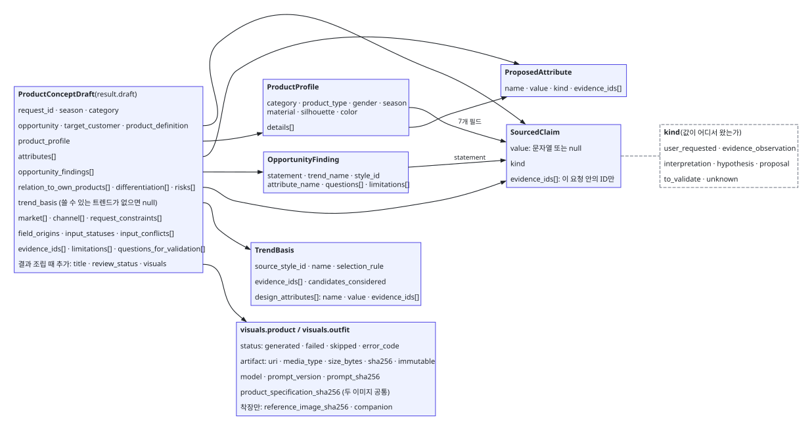

# Draft 데이터 모델

응답의 `result.draft`는 신상품 기획안 초안이다. 값마다 출처를 기록해서, 검토자가 무엇이 사용자 요청이고 무엇이 근거에서 왔고 무엇이 서비스의 제안인지 구분할 수 있게 한다.

<picture>
  <source media="(prefers-color-scheme: dark)" srcset="diagrams/draft-model-dark.svg">
  
</picture>

필드 목록은 `src/fashion_planner_novelty/domain/concept.py`의 dataclass를 따른다. 그림의 근거는 [diagrams/CLAIMS.md](diagrams/CLAIMS.md)에 있다.

## 출처가 있는 값: `SourcedClaim`

| 필드 | 뜻 |
|---|---|
| `value` | 값. 근거가 없으면 `null`일 수 있다 |
| `kind` | 값이 어디서 왔는가(아래 표) |
| `evidence_ids` | 이 값을 뒷받침하는 근거 ID. **이 요청의 입력에 있는 ID만** 쓸 수 있다 |

| `kind` | 뜻 |
|---|---|
| `user_requested` | 사용자가 요청에서 직접 정한 값 |
| `evidence_observation` | 트렌드·재고 근거에서 관찰한 값. 근거 ID가 반드시 있다 |
| `interpretation` | 근거를 해석한 문장 |
| `hypothesis` | 검증이 필요한 가설 |
| `proposal` | 입력이 다루지 않아 서비스가 제안한 값. 근거가 아니다 |
| `to_validate` | 확인이 필요한 값 |
| `unknown` | 알 수 없음 |

## 상품 프로필: `product_profile`

`category`, `product_type`, `gender`, `season`, `material`, `silhouette`, `color` 7개 값과 디테일 목록 `details`가 있다.

- 사용자가 요청한 값이 가장 우선한다.
- 그다음은 주 트렌드에서 근거가 연결된 값이다. 소재와 실루엣은 근거 값이 하나일 때만 올린다. 색은 근거 색이 여럿이면 입력 순서상 첫 색을 쓴다.
- 입력이 다루지 않는 디자인 필드는 카테고리에 따른 정해진 제안값으로 채우고 `kind: "proposal"`로 표시한다. 예를 들어 아우터는 "가벼운 아우터", "나일론 혼방", "레귤러 핏", "뉴트럴 톤"이다.
- `gender`는 `women`, `men`, `unisex`, `unknown` 중 하나다(research 서비스가 받는 값과 같다). 성별을 요청하지 않으면 `"unknown"`(`proposal`)이다. 카테고리나 다른 속성에서 성별을 추론하지 않는다.
- 이미지 사양은 이 프로필에서만 만든다.

### research로 넘어가는 값

orchestrator는 이 프로필 중 일부만 research 요청으로 옮긴다.

- 넘기는 필드는 `category`, `product_type`, `gender`, `season`, `material` 5개와, 필드마다 출처(`kind`, `source_ref` = `novelty.draft.product_profile.<필드>`, `evidence_ids`)다. `silhouette`, `color`, `details`는 넘기지 않는다.
- `category`는 `draft.category`와 같아야 한다.
- `kind`가 `user_requested`, `evidence_observation`, `proposal`인 값만 그대로 넘긴다. 그 밖의 `kind`이거나 값이 비어 있으면 orchestrator가 정해진 자리값으로 바꾸고 `kind: "proposal"`로 표시한다.
- research는 다섯 필드의 문자열을 120자까지만 받는다. novelty는 모델이 낸 값을 3,000자까지 받으므로, 120자를 넘는 값이 나오면 research 단계가 요청 오류로 끝날 수 있다(현재 한계).

## 주 트렌드 기록: `trend_basis`

Draft가 기준으로 삼은 트렌드 하나를 기록한다. 쓸 수 있는 트렌드가 없으면 `null`이다.

| 필드 | 뜻 |
|---|---|
| `source_style_id`, `name` | 트렌드 결과의 style ID와 이름 |
| `selection_rule` | 선택 규칙 이름(`most_evidence_linked_design_attributes`) |
| `evidence_ids` | 트렌드·설명·속성의 근거 ID |
| `design_attributes` | 규칙이 센, 근거가 연결된 디자인 속성 |
| `candidates_considered` | 검토한 쓸 수 있는 후보 수 |

## 시각자료: `visuals.product`, `visuals.outfit`

| 필드 | 뜻 |
|---|---|
| `status` | `generated`, `failed`, `skipped` |
| `error_code` | 실패·건너뜀의 안전한 오류 코드(예: `IMAGE_PROVIDER_NOT_CONFIGURED`, `OUTFIT_REFERENCE_UNAVAILABLE`) |
| `artifact` | 생성했을 때만: `uri`(`artifact://novelty/images/<sha256>.<ext>`), `media_type`, `size_bytes`, `sha256`, `immutable` |
| `model`, `prompt_version`, `prompt_sha256` | 이미지 모델과 프롬프트 템플릿 식별 |
| `product_specification_sha256` | 두 이미지가 공유하는 상품 사양 JSON의 해시 |
| `reference_image_sha256` | 착장만: 편집 입력으로 쓴 상품 이미지의 해시 |
| `companion` | 착장만: 함께 입힌 재고 상품(style ID, 카테고리, 순위, 역할, 선택 규칙, 사진 해시). 없으면 `null` |

이미지 바이트는 응답에 넣지 않는다. 저장 위치는 [operations.md](operations.md)에 있다.

## 예시

[빠른 시작](../README.md#빠른-시작오프라인)의 합성 요청을 텍스트 LLM과 이미지 없이 처리한 결과의 일부다.

```json
{
  "product_profile": {
    "category":   {"value": "Outerwear",  "kind": "user_requested",       "evidence_ids": []},
    "product_type": {"value": "가벼운 아우터", "kind": "proposal",         "evidence_ids": []},
    "gender":     {"value": "unknown",    "kind": "proposal",             "evidence_ids": []},
    "season":     {"value": "2027SS",     "kind": "user_requested",       "evidence_ids": []},
    "material":   {"value": "nylon",      "kind": "evidence_observation", "evidence_ids": ["SYN-EVIDENCE-2"]},
    "silhouette": {"value": "레귤러 핏",   "kind": "proposal",             "evidence_ids": []},
    "color":      {"value": "olive",      "kind": "evidence_observation", "evidence_ids": ["SYN-EVIDENCE-2"]},
    "details": [
      {"name": "detail", "value": "patch pockets", "kind": "evidence_observation", "evidence_ids": ["SYN-EVIDENCE-2"]}
    ]
  },
  "trend_basis": {
    "source_style_id": "SYN-STYLE-1",
    "name": "Utility layering",
    "selection_rule": "most_evidence_linked_design_attributes",
    "evidence_ids": ["SYN-EVIDENCE-1", "SYN-EVIDENCE-2"]
  }
}
```

## 그 밖의 필드

| 필드 | 뜻 |
|---|---|
| `opportunity`, `target_customer`, `product_definition` | 기회 문장, 타깃 고객, 상품 정의(`SourcedClaim`) |
| `attributes` | Draft에 반영한 디자인 속성(`ProposedAttribute`) |
| `opportunity_findings` | 기회 분석 근거 문장과 트렌드 연결 |
| `relation_to_own_products` | 기존 재고와의 관계(코디 맥락, 재고 스냅샷) |
| `differentiation`, `risks` | 차별점, 위험(모델이 비우면 빈 목록으로 둔다) |
| `field_origins`, `input_statuses`, `input_conflicts` | 요청 필드의 출처, 입력별 상태, 입력 간 충돌 |
| `limitations`, `questions_for_validation` | 한계와 검토 질문 |
| `title`, `review_status` | 결과를 조립할 때 붙인다. `review_status`는 늘 `md_review_required`다 |
